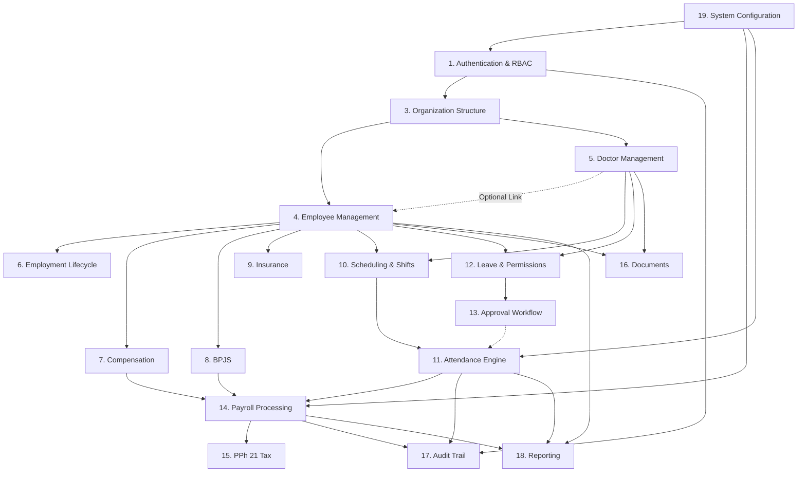

# SOFTWARE REQUIREMENTS SPECIFICATION (SRS) — HOSPITAL HR, PAYROLL & ATTENDANCE SYSTEM

**Document Identifier**: `/docs/01-requirements.md`  
**System Name**: Hospital Human Resources, Payroll, Attendance, and Doctor Scheduling System  
**Hospital Target**: Single Hospital Enterprise Deployment (Juwita Hospital)  
**Role**: Senior Business Analyst & Requirements Engineer  
**Status**: APPROVED REQUIREMENTS SPECIFICATION  

---

## 1. SYSTEM CONTEXT & SCOPE

The system is a centralized human resource, scheduling, attendance, and payroll management platform tailored specifically for a single hospital. It unifies administrative personnel, clinical support staff, and doctors into a unified system with strict regulatory compliance (Indonesian labor law, BPJS, and PPh 21 tax rules).

### 1.1 In-Scope Capabilities
- Organization Structure & Hospital Hierarchy
- Employee Lifecycle & Contract Management (with historical tracking)
- Doctor Registry & Professional Credentials (STR/SIP expiration management)
- Shift & Rotation Scheduling (including overnight shifts & on-call rosters)
- Multi-Factor Biometric & Geofenced Attendance (Device + GPS + Passive Liveness + Face AI)
- Multi-Tier Leave & Permission Workflow
- Effective-Dated Compensation, Allowances & Deductions
- Regulatory BPJS Kesehatan & BPJS Ketenagakerjaan Calculations
- Indonesian Income Tax (PPh 21) Calculations (TER PP 58/2023 & Annual PTKP)
- Immutable Component-Based Payroll Processing & Bank Export
- Google Workspace Shared Drive Document Management
- Tamper-Evident Audit Logging

### 1.2 Explicit Out-of-Scope (Strict Non-Requirements)
- **Multi-Tenancy**: No multi-tenant data structures, `tenant_id`, or hospital-switching mechanisms.
- **Medical Service Fees (Jasa Medis)**: Absolute prohibition. System does **not** calculate patient revenue sharing, medical fee points, clinical billing, or doctor fee distribution from patient procedures.
- **Clinical Information Systems**: Electronic Medical Records (EMR/EHR), patient registration, pharmacy, triage, laboratory, inpatient billing, and BPJS health insurance claim processing.

---

## 2. SYSTEM ACTORS & ACCESS MATRIX

| Actor | Primary Responsibility | View | Create / Update | Approve / Reject | Finalize / Lock | Export / Download |
|---|---|---|---|---|---|---|
| **Super Admin** | System maintenance, tenant configuration, role allocation | System-wide (Break-glass) | System configs, roles, user accounts | Emergency overrides (Audited) | None | System diagnostics & audit trails |
| **HR Admin** | Operational personnel data, contracts, shift schedules | Employees, Doctors, Rosters, Attendance, Leaves | Employee profiles, credentials, schedule assignments | None | None | Attendance summaries, staff rosters |
| **HR Manager** | HR policy enforcement, approval authority | All HR, Attendance, Leave, Compensation profiles | Leave policies, shift templates, salary structures | Tier-2 Leaves, attendance adjustments, schedule overrides | None | Departmental HR metrics, compliance reports |
| **Supervisor** | Unit / Ward team leadership | Subordinate staff in assigned Department/Unit | Schedule shift requests, overtime requests | Tier-1 Leaves, shift swaps, subordinate adjustments | None | Unit attendance sheets |
| **Payroll** | Salary calculation, tax deduction, statutory compliance | Compensation profiles, attendance totals, payroll runs | Payroll periods, ad-hoc adjustments, tax parameters | None | Submits run for approval | Payroll draft sheets, bank transfer files |
| **Finance** | Financial validation and fund release | Finalized payroll runs, disbursement reports | Payment transaction reference | Approves final payroll run | Signs off / Locks Finalized Payroll | Statutory tax reports (1721-A1), Bank files |
| **Doctor** | Medical practitioner self-service | Own schedule, own attendance, own credentials | Profile updates (contact), leave requests | None | None | Own schedule, own payslips (if employee) |
| **Employee** | Hospital staff self-service | Own schedule, own attendance, own leave balances | Profile updates (contact), leave requests | None | None | Own monthly payslips, schedule |

---

## 3. BUSINESS DOMAIN CATALOG

### Domain Specifications
1. **Authentication & RBAC**: Identity verification, session cookies, Sanctum API tokens, policy gates.
2. **Authorization**: Strict role-to-permission mapping and unit-based organizational scoping.
3. **Organization Structure**: Division, Department, Unit, Working Station, Position hierarchy.
4. **Employee Management**: Personal bio data, identification, family records, education, bank accounts.
5. **Doctor Management**: Physician directory, SIP, STR, validity monitoring, Poly assignment.
6. **Employment Lifecycle**: Contracts (PKWT, PKWTT, Internship), probation, tenure, and historical tracking.
7. **Compensation**: Base salary, recurring allowances (functional, hazard, transport, night duty).
8. **BPJS**: BPJS Kesehatan (4% employer / 1% employee) and Ketenagakerjaan (JKK, JKM, JHT, JP).
9. **Insurance**: Private supplementary health and hospital insurance coverage.
10. **Scheduling & Shifts**: Roster planning, rotational schedules, 24/7 hospital shifts, overnight logic.
11. **Attendance Engine**: Multi-factor clock-in validation (Device + GPS Geofence + Passive Liveness + Face AI).
12. **Leave & Permissions**: Entitlement accrual, leave requests, medical certificates, quota decrementing.
13. **Approval Workflow**: Configurable multi-stage approval routing for leaves, schedule swaps, and payroll.
14. **Payroll Processing**: Component-based salary calculation, deductions, net pay, immutable finalization.
15. **Tax (PPh 21)**: Progressive income tax calculations using effective rates (TER PP 58/2023) and PTKP.
16. **Documents**: Google Drive Shared Drive document integration, metadata catalog, presigned URLs.
17. **Audit Logging**: Immutable, sanitized event journal recording actor, action, resource, and diff.
18. **Reporting**: Bank transfer outputs (BCA, Mandiri, BNI), SPT PPh 21, and staff attendance recaps.
19. **System Configuration**: Effective-dated regulatory parameters, hospital coordinates, and geofence radii.

---

## 4. FUNCTIONAL REQUIREMENTS CATALOG

### 4.1 Authentication & Security (HR-AUTH)

#### HR-AUTH-001: Multi-Role User Authentication
- **Description**: The system shall authenticate users via email and password with brute-force rate limiting.
- **Priority**: MUST
- **Actor**: All Actors
- **Acceptance Criteria**:
  - *Valid Case*: User provides registered email and valid password; authenticated session is established, and actor is redirected to role-appropriate dashboard.
  - *Invalid Case*: User inputs invalid password 5 times in 1 minute; account login is throttled for 60 seconds with 429 Too Many Requests response.
  - *Expected Result*: Session created securely with HTTPS-only cookies; login event recorded in audit logs.
- **Dependencies**: None

#### HR-AUTH-002: Organizational Scope Enforcement
- **Description**: The system shall restrict supervisors and unit heads to accessing only employees within their assigned department or organizational unit.
- **Priority**: MUST
- **Actor**: Supervisor, HR Admin
- **Acceptance Criteria**:
  - *Valid Case*: Supervisor views employee roster for their assigned Emergency Room (ER) unit; list returns only ER personnel.
  - *Invalid Case*: Supervisor attempts direct URL access `/employees/{id}` of an employee in ICU; system throws 403 Forbidden.
  - *Expected Result*: Scoped database queries enforce organizational boundaries.
- **Dependencies**: HR-AUTH-001, HR-ORG-001

---

### 4.2 Organization Structure (HR-ORG)

#### HR-ORG-001: Hierarchical Hospital Organization Chart
- **Description**: The system shall model Divisions, Departments, Units, and Positions with parent-child relationships.
- **Priority**: MUST
- **Actor**: HR Admin, HR Manager
- **Acceptance Criteria**:
  - *Valid Case*: HR Admin creates Department "Nursing" under Division "Medical Services", and Unit "ICU" under "Nursing"; hierarchy reflects accurately.
  - *Invalid Case*: HR Admin attempts to delete a Department that still contains active Units or Employees; operation rejected with dependency warning.
  - *Expected Result*: Referential integrity enforced; active employees cannot be orphaned.
- **Dependencies**: None

---

### 4.3 Employee Management (HR-EMP)

#### HR-EMP-001: Employee Bio Data & Lifecycle Management
- **Description**: The system shall manage full employee demographic records, family data, tax IDs (NPWP), social security IDs, and bank account numbers.
- **Priority**: MUST
- **Actor**: HR Admin
- **Acceptance Criteria**:
  - *Valid Case*: HR Admin submits new employee record with unique NIP (Nomor Induk Pegawai); record created and audit log captures event.
  - *Invalid Case*: Duplicate NIP or invalid email format submitted; validation fails with specific field error messages.
  - *Expected Result*: Employee record stored with encrypted sensitive columns (bank account, KTP).
- **Dependencies**: HR-ORG-001

#### HR-EMP-002: Effective-Dated Employment & Salary History
- **Description**: The system shall maintain historical employment contracts and salary revisions with effective start and end dates without overwriting prior records.
- **Priority**: MUST
- **Actor**: HR Admin, HR Manager
- **Acceptance Criteria**:
  - *Valid Case*: Employee base salary raised from Rp 5,000,000 to Rp 6,000,000 effective November 1, 2026; previous salary record sets `effective_to = 2026-10-31`, new record sets `effective_from = 2026-11-01`.
  - *Invalid Case*: Overlapping active effective date ranges submitted for the same salary component; system blocks operation.
  - *Expected Result*: Historical payroll calculation for October 2026 accurately uses Rp 5,000,000; November uses Rp 6,000,000.
- **Dependencies**: HR-EMP-001

---

### 4.4 Doctor Management (HR-DOC)

#### HR-DOC-001: Independent Doctor Registry & Credential Tracking
- **Description**: The system shall maintain doctors in a dedicated domain with professional credentials (STR, SIP, issuing councils, expiration dates).
- **Priority**: MUST
- **Actor**: HR Admin, Doctor
- **Acceptance Criteria**:
  - *Valid Case*: Doctor profile created with SIP license number and expiry date; automated reminder flagged 60 days before expiration.
  - *Invalid Case*: Doctor profile registered without mandatory medical council registration number; validation blocks creation.
  - *Expected Result*: Doctor record created with independent scheduling capability.
- **Dependencies**: None

#### HR-DOC-002: Optional Doctor-Employee Payroll Association
- **Description**: The system shall allow an organic doctor to be linked optionally to an Employee record for hospital payroll purposes.
- **Priority**: MUST
- **Actor**: HR Admin
- **Acceptance Criteria**:
  - *Valid Case*: Organic hospital doctor linked to Employee ID #105; doctor appears in monthly payroll run for standard base salary/allowances.
  - *Valid Case (External Doctor)*: Partner doctor registered without Employee link; excluded from monthly payroll processing, but scheduled in clinical roster.
  - *Invalid Case*: Attempt to assign an employee link that belongs to a non-existent employee; rejected with foreign key validation error.
  - *Expected Result*: Clear separation of external doctor scheduling vs. organic doctor payroll.
- **Dependencies**: HR-DOC-001, HR-EMP-001

#### HR-DOC-003: Strict Exclusion of Medical Service Fees (Jasa Medis)
- **Description**: The system shall strictly prevent any calculation or configuration of medical service fees, patient revenue sharing, or procedure-based fees.
- **Priority**: MUST
- **Actor**: All Actors
- **Acceptance Criteria**:
  - *Valid Case*: Payroll engine processes doctor payroll using fixed base salary and fixed hospital allowances only.
  - *Invalid Case*: Configuration of variable commission or per-patient fee points; not supported by database schema or UI.
  - *Expected Result*: 100% compliance with non-functional constitutional scope.
- **Dependencies**: HR-DOC-002

---

### 4.5 Scheduling & Shifts (HR-SCH)

#### HR-SCH-001: 24/7 Hospital Shift Templates & Overnight Shifts
- **Description**: The system shall support customizable shift definitions, including day shifts, night shifts crossing midnight, and on-call shifts.
- **Priority**: MUST
- **Actor**: HR Admin, HR Manager
- **Acceptance Criteria**:
  - *Valid Case*: Night shift created (21:00 to 07:00 next day) with cross-midnight flag; attendance engine recognizes check-outs up to 07:30 as valid shift checkout.
  - *Invalid Case*: Shift created where `start_time == end_time` without cross-midnight flag; validation fails.
  - *Expected Result*: Shifts stored with designated late tolerances and break periods.
- **Dependencies**: None

#### HR-SCH-002: Departmental Roster Scheduling & Conflict Prevention
- **Description**: The system shall allow scheduling monthly staff rosters per department and detect overlapping shift assignments.
- **Priority**: MUST
- **Actor**: Supervisor, HR Admin
- **Acceptance Criteria**:
  - *Valid Case*: Supervisor assigns monthly shifts to 20 ward nurses across 3 rotating shifts; roster published successfully.
  - *Invalid Case*: Supervisor assigns Nurse A to Morning Shift (07:00-14:00) and Afternoon Shift (14:00-21:00) on the same date without explicit double-shift override; system warns of scheduling conflict.
  - *Expected Result*: Clean schedule calendar visible to employees in self-service.
- **Dependencies**: HR-SCH-001, HR-ORG-001

---

### 4.6 Attendance Engine (HR-ATT)

#### HR-ATT-001: Multi-Factor Attendance Verification Pipeline
- **Description**: The system shall validate employee/doctor check-in through an ordered sequence: Device Fingerprint $\rightarrow$ GPS Geofence $\rightarrow$ Passive Liveness $\rightarrow$ Facial Similarity Match.
- **Priority**: MUST
- **Actor**: Employee, Doctor
- **Acceptance Criteria**:
  - *Valid Case*: Staff clocks in inside hospital geofence (50m from center), liveness score 0.98, face similarity 0.92 against enrolled vector; check-in approved and attendance event logged.
  - *Invalid Case (Geofence)*: Staff attempts clock-in 2 kilometers away from hospital; request rejected with "Outside Hospital Perimeter" error.
  - *Invalid Case (Spoof)*: Static photo presented to camera; liveness check returns `is_live = false`; check-in rejected with security incident logged.
  - *Expected Result*: Complete verification evidence stored with raw GPS, device ID, and similarity score.
- **Dependencies**: HR-SCH-002, HR-FACE-001

#### HR-ATT-002: Lateness, Early Leave, and Absence Processing
- **Description**: The system shall automatically compute lateness minutes, early departures, and unexcused absences by comparing attendance events with scheduled shifts.
- **Priority**: MUST
- **Actor**: System (Automated Daily Engine)
- **Acceptance Criteria**:
  - *Valid Case*: Scheduled at 08:00 with 15-minute grace period; staff clocks in at 08:25; system records 10 minutes of late penalty.
  - *Valid Case*: Staff fails to check in and has no approved leave; system automatically flags shift as "ALPHA / Unexcused Absence" at shift conclusion.
  - *Invalid Case*: System calculating absence for staff with an approved medical leave; absence computation suppressed.
  - *Expected Result*: Accurate daily attendance summary feeding payroll deductions.
- **Dependencies**: HR-ATT-001, HR-LEV-001

#### HR-ATT-003: Auditable Manual Attendance Adjustment
- **Description**: The system shall allow supervisors to request attendance corrections with mandatory reason notes and manager approval.
- **Priority**: MUST
- **Actor**: Supervisor, HR Manager
- **Acceptance Criteria**:
  - *Valid Case*: Staff forgot check-out during emergency surgery; Supervisor submits manual check-out time adjustment with justification; HR Manager approves; record adjusted.
  - *Invalid Case*: Supervisor submits adjustment without justification text; validation blocks submission.
  - *Expected Result*: Original raw event preserved; adjustment linked with `adjusted_by` and `approved_by` audit fields.
- **Dependencies**: HR-ATT-002, HR-APP-001

---

### 4.7 Leave & Permissions (HR-LEV)

#### HR-LEV-001: Leave Entitlement, Quota Accrual & Balance Deduction
- **Description**: The system shall track annual leave entitlements, maternity leaves, sick leaves, and compassionate leaves with automatic balance decrementing.
- **Priority**: MUST
- **Actor**: Employee, Doctor, HR Admin
- **Acceptance Criteria**:
  - *Valid Case*: Employee with 12 days annual balance applies for 3 days; upon final approval, balance decrements to 9 days.
  - *Invalid Case*: Employee requests 5 days annual leave but has only 2 days remaining; application blocked with "Insufficient Leave Balance".
  - *Expected Result*: Atomic balance update utilizing row-level database locking to prevent concurrent balance overdrafts.
- **Dependencies**: HR-EMP-001

#### HR-LEV-002: Leave Application & Multi-Tier Approval State Machine
- **Description**: Leave requests shall strictly transition through: DRAFT $\rightarrow$ SUBMITTED $\rightarrow$ PENDING_APPROVAL $\rightarrow$ APPROVED / REJECTED $\rightarrow$ CANCELLED.
- **Priority**: MUST
- **Actor**: Employee, Doctor, Supervisor, HR Manager
- **Acceptance Criteria**:
  - *Valid Case*: Leave approved by Supervisor moves to PENDING_HR; approved by HR Manager transitions to APPROVED and emits `LeaveApprovedEvent`.
  - *Invalid Case*: Staff attempts to cancel an APPROVED leave after the leave start date has already passed; cancellation rejected.
  - *Expected Result*: Attendance engine reflects approved leave as authorized absence.
- **Dependencies**: HR-LEV-001, HR-APP-001

---

### 4.8 Payroll Processing (HR-PAY)

#### HR-PAY-001: Component-Based Payroll Run Execution
- **Description**: The system shall calculate monthly payroll by aggregating base salary, recurring allowances, overtime pay, late penalties, BPJS deductions, and PPh 21 tax.
- **Priority**: MUST
- **Actor**: Payroll Administrator, Finance
- **Acceptance Criteria**:
  - *Valid Case*: Payroll Admin executes October 2026 payroll run; system batches all active employees, calculates individual gross-to-net items, and transitions run to DRAFT_CALCULATED.
  - *Invalid Case*: Payroll run executed for a period that already has a FINALIZED run; execution rejected.
  - *Expected Result*: Detailed itemized line-items created for base, allowances, deductions, and net pay.
- **Dependencies**: HR-EMP-002, HR-ATT-002, HR-BPJS-001, HR-TAX-001

#### HR-PAY-002: Immutable Finalized Payroll & Adjustment Mechanism
- **Description**: Once approved by Finance, a payroll run shall transition to FINALIZED and become completely immutable to updates or deletions.
- **Priority**: MUST
- **Actor**: Finance, HR Director
- **Acceptance Criteria**:
  - *Valid Case*: Finance clicks "Finalize Payroll"; status becomes FINALIZED; database triggers and policy prevent any `UPDATE` or `DELETE` on run and child items.
  - *Invalid Case*: Super Admin attempts direct database update on finalized net pay; database constraint/policy blocks mutation.
  - *Expected Result*: Retroactive salary corrections booked as explicit adjustment items in the subsequent pay cycle.
- **Dependencies**: HR-PAY-001

#### HR-PAY-003: Bank Disbursement File Generation
- **Description**: The system shall generate batch transfer disbursement files formatted for major Indonesian commercial banks (BCA Payroll, Mandiri Corporate, BNI Direct).
- **Priority**: MUST
- **Actor**: Finance
- **Acceptance Criteria**:
  - *Valid Case*: Finance selects "Export BCA Format" on a finalized run; system outputs formatted CSV with employee account numbers, amounts, and transaction codes.
  - *Invalid Case*: Export requested on an unfinalized DRAFT payroll run; export prohibited.
  - *Expected Result*: Standardized bank file generated for upload to corporate banking portal.
- **Dependencies**: HR-PAY-002

---

### 4.9 Statutory BPJS & PPh 21 Tax (HR-BPJS & HR-TAX)

#### HR-BPJS-001: Configurable BPJS Health & Employment Calculations
- **Description**: The system shall calculate BPJS Kesehatan (4% employer, 1% employee up to salary ceiling) and BPJS Ketenagakerjaan (JKK, JKM, JHT 3.7%/2%, JP 2%/1%) using effective-dated regulatory rates.
- **Priority**: MUST
- **Actor**: Payroll Administrator
- **Acceptance Criteria**:
  - *Valid Case*: Employee with salary Rp 15,000,000 processed for BPJS Kesehatan with ceiling Rp 12,000,000; deduction calculated on Rp 12,000,000 ceiling.
  - *Invalid Case*: Hardcoded percentage used instead of effective-dated database configuration; prohibited by architecture.
  - *Expected Result*: Accurate employer cost and employee deduction split.
- **Dependencies**: HR-PAY-001

#### HR-TAX-001: PPh 21 Calculations via Tarif Efektif Rata-Rata (TER)
- **Description**: The system shall calculate monthly employee income tax withholding based on Indonesian Government Regulation PP 58/2023 (TER Category A, B, C) and annual Form 1721-A1 reconciliation.
- **Priority**: MUST
- **Actor**: Payroll Administrator
- **Acceptance Criteria**:
  - *Valid Case*: Employee with PTKP status TK/0 and gross income Rp 8,000,000 matched to TER Category A; correct percentage withheld.
  - *Invalid Case*: Tax bracket applied without verifying effective start date; calculation blocked.
  - *Expected Result*: Withholding amount logged per employee with annual cumulative gross tracking.
- **Dependencies**: HR-PAY-001

---

### 4.10 Document Storage & Google Drive (HR-DOCS)

#### HR-DOCS-001: Google Drive Shared Drive Integration
- **Description**: The system shall store employee and doctor sensitive documents (KTP, STR, SIP, Contracts) in Google Workspace Shared Drive via service account.
- **Priority**: MUST
- **Actor**: HR Admin, Employee, Doctor
- **Acceptance Criteria**:
  - *Valid Case*: HR Admin uploads Doctor SIP document; file streamed to Google Shared Drive folder `/doctors/{uuid}/sip/`; Google Drive file ID saved in local DB.
  - *Invalid Case*: Uploading executable file (.exe, .sh) or file exceeding 10MB; upload rejected with MIME validation error.
  - *Expected Result*: File safely stored in Google Drive; database maintains metadata only.
- **Dependencies**: None

#### HR-DOCS-002: Signed Temporary Document Preview URLs
- **Description**: The system shall forbid public Google Drive sharing links; all document previews shall use signed, time-limited application proxy URLs.
- **Priority**: MUST
- **Actor**: All Authorized Actors
- **Acceptance Criteria**:
  - *Valid Case*: Doctor views own SIP; system generates 15-minute temporary signed preview link.
  - *Invalid Case*: Unauthorized staff attempts access to another employee's KTP preview URL; authorization policy throws 403 Forbidden.
  - *Expected Result*: Zero public Google Drive link exposure.
- **Dependencies**: HR-DOCS-001

---

### 4.11 Face AI Integration (HR-FACE)

#### HR-FACE-001: External Face AI Verification & Passive Liveness
- **Description**: The system shall communicate with the external Face AI microservice to extract 128-d/512-d feature vectors, test passive anti-spoofing, and perform 1:1 similarity matching.
- **Priority**: MUST
- **Actor**: Employee, Doctor (during check-in)
- **Acceptance Criteria**:
  - *Valid Case*: Camera frame sent to Face AI; returns liveness score >= 0.85 and cosine similarity >= 0.85 against stored template; verification succeeds.
  - *Invalid Case*: Camera frame is empty, blurry, or no face detected; Face AI returns specific diagnostic error; system prompts user to align face.
  - *Expected Result*: Stateless Face AI processes request without persisting employee identity.
- **Dependencies**: None

#### HR-FACE-002: Biometric Feature Vector Protection
- **Description**: The system shall permanently delete raw facial images after template enrollment and store only encrypted mathematical vectors.
- **Priority**: MUST
- **Actor**: System
- **Acceptance Criteria**:
  - *Valid Case*: Employee enrolls face; embedding vector generated; raw photo purged from memory/disk; vector stored with database encryption.
  - *Invalid Case*: HR Admin requests to download raw biometric face template; operation completely unsupported by API and UI.
  - *Expected Result*: Strict compliance with biometric privacy mandates.
- **Dependencies**: HR-FACE-001

---

### 4.12 Audit Trail (HR-AUD)

#### HR-AUD-001: Immutable Audit Logging & Sensitive Data Masking
- **Description**: The system shall automatically record all sensitive mutations (salary changes, payroll finalization, leave approvals, attendance adjustments) and mask all credentials/biometrics.
- **Priority**: MUST
- **Actor**: System
- **Acceptance Criteria**:
  - *Valid Case*: HR updates employee bank account; audit log records user ID, IP address, action `employee.updated`, and sanitized diff.
  - *Invalid Case*: User password, token, or face embedding passed into log payload; system masks values with `[REDACTED]`.
  - *Expected Result*: Append-only `audit_logs` record created with no update or delete capabilities.
- **Dependencies**: None

---

## 5. NON-FUNCTIONAL REQUIREMENTS (NFR)

| ID | Category | Requirement Statement | Priority |
|---|---|---|---|
| **NFR-SEC-001** | Security | All client-to-server and server-to-external communication must enforce TLS 1.3 encryption. Internal services must reside on isolated Docker private bridges. | MUST |
| **NFR-SEC-002** | Security | Passwords must be hashed using Bcrypt with cost factor 12. Sensitive database attributes (KTP, bank accounts, biometric vectors) must use AES-256 application encryption. | MUST |
| **NFR-PRV-001** | Privacy | Raw facial images must never be stored on persistent disks after enrollment vector generation. Face templates must never be stored in Google Drive. | MUST |
| **NFR-PERF-001** | Performance | Face verification and check-in pipeline (Device + GPS + Liveness + Match) must complete end-to-end within 2.5 seconds under standard 4G connectivity. | MUST |
| **NFR-PERF-002** | Performance | Monthly payroll calculation batch for 1,000 hospital employees must complete within 60 seconds using queued chunk processing. | MUST |
| **NFR-AVAIL-001** | Availability | Target system uptime of 99.9% during hospital working operations, supported by automated container health checks and database WAL replication. *(Proposed)* | SHOULD |
| **NFR-AUD-001** | Auditability | Audit log entries must be append-only and immutable. No user, including Super Admin, shall have UI or application capabilities to edit or purge audit records. | MUST |
| **NFR-USAB-001** | Usability | Desktop HR interfaces must be optimized for dense data entry and navigation; mobile attendance portals must be responsive, touch-friendly, and accessible. | MUST |

---

## 6. OPEN QUESTIONS (HOSPITAL POLICY ALIGNMENT)

The following 8 operational parameters are flagged as policy decisions requiring formal confirmation from Juwita Hospital management before final production deployment:

1. **Geofence Boundary Radius**: What is the exact permitted GPS radius from the hospital center coordinates? *(Proposed default: 100 meters)*.
2. **Grace Period for Late Arrival**: Does the hospital permit a standard grace period before late penalties apply? *(Proposed default: 15 minutes)*.
3. **Overtime Authorization Policy**: Does overtime require pre-shift supervisor approval, or can post-shift actual attendance hours automatically generate overtime requests?
4. **Leave Accrual Horizon**: Do unused annual leave entitlements roll over into the subsequent calendar year, or do they expire annually on December 31?
5. **Approval Hierarchy for Doctors**: Should clinical doctor leave requests route through the Medical Services Director or the respective Poly / Department Head?
6. **Payroll Cutoff Window**: What is the exact recurring payroll attendance cutoff date? *(Proposed default: 21st of previous month to 20th of current month)*.
7. **Document Retention Period**: What is the statutory retention duration for terminated employee records and expired doctor SIP/STR documents? *(Proposed default: 10 years)*.
8. **Attendance Audit Evidence Retention**: How long should non-biometric attendance diagnostic logs (coordinates, device IP, similarity scores) be stored before archival? *(Proposed default: 24 months)*.

---

## 7. SRS SUMMARY & VERIFICATION METRICS

- **Functional Requirements Count**: 20 Formal Requirements
  - Authentication & Scoping: 2
  - Organization: 1
  - Employee Management: 2
  - Doctor Management: 3
  - Scheduling & Shifts: 2
  - Attendance Engine: 3
  - Leave & Approval: 2
  - Payroll Processing: 3
  - Statutory BPJS & Tax: 2
  - Document Management: 2
  - Face AI: 2
  - Audit Trail: 1
- **Non-Functional Requirements Count**: 8 Specifications (Security, Privacy, Performance, Availability, Auditability, Usability).
- **Open Questions Count**: 8 Policy Confirmation Items.
- **Major Assumptions**:
  - The hospital maintains an active Google Workspace account with Shared Drive provisioned for enterprise document storage.
  - The hospital deploys an on-premise Docker server equipped with sufficient CPU/GPU capacity to host PostgreSQL, Redis, Laravel, and the Python Face AI microservice.
  - Medical service fees (Jasa Medis) remain 100% excluded from this HR/Payroll system.
- **Key Dependencies**:
  - PostgreSQL 16 relational database engine.
  - Google Drive API v3 and Google Service Account credentials.
  - External Face AI microservice container providing REST endpoints for liveness and feature vector comparison.
- **Recommended Next Document**:
  - [docs/03-database.md](file:///Users/bagas/Projects/Other-copy/payroll-juwita/docs/03-database.md) (**PROMPT 03 — DATABASE ARCHITECTURE AND ERD**) to formalize all normalized tables, foreign keys, constraints, and effective dating schemas.
