# SYSTEM ARCHITECTURE SPECIFICATION — HOSPITAL HR, PAYROLL & ATTENDANCE SYSTEM

**Document Identifier**: `/docs/02-architecture.md`  
**System**: Hospital Human Resources, Payroll, Attendance, and Doctor Scheduling  
**Target Organization**: Single Hospital Production System  
**Role**: Senior Software Architect  
**Status**: APPROVED ARCHITECTURE BASELINE  

---

## 1. ARCHITECTURE GOAL & SYSTEM TOPOLOGY

The system is designed as a maintainable, modular monolithic Laravel application integrated with an isolated, external Face AI microservice and Google Drive for document object storage.

### 1.1 High-Level System Topology

```mermaid
graph TD
    Client["Client Browsers / Mobile Devices"] -->|HTTPS / TLS 1.3| Nginx["Nginx Reverse Proxy & SSL Termination"]
    
    subgraph "Internal Application Network (Isolated Docker Bridge)"
        Nginx -->|FastCGI / HTTP| Laravel["Laravel Application Monolith (PHP 8.4)"]
        
        Laravel -->|SQL / Port 5432| Postgres[("PostgreSQL 16 (Primary ACID Database)")]
        Laravel -->|RESP / Port 6379| Redis[("Redis 7 (Queues, Cache, Locks, Throttling)")]
        
        Workers["Laravel Queue Workers & Scheduler"] --> Postgres
        Workers --> Redis
        
        Laravel -->|Internal REST / Port 8001| FaceAI["Face AI Microservice (Python / FastAPI / ONNX)"]
    end
    
    subgraph "External Cloud Infrastructure"
        Workers -->|Google Drive API v3 (Service Account)| GDrive["Google Workspace Shared Drive (Documents)"]
    end
```

### 1.2 Core Architectural Principles
1. **Single Hospital Authority**: The application is strictly single-tenant. No# PROMPT 02 — SYSTEM ARCHITECTURE

You are acting as a Senior Software Architect.

Read completely:

- `/docs/00-project-constitution.md`
- `/docs/01-requirements.md`

Do NOT write application code.

Do NOT create migrations.

Do NOT install packages.

Your task is to design the technical architecture for the Hospital HR Management System.

---

# 1. ARCHITECTURE GOAL

Design a maintainable monolithic Laravel application with a separate Face AI service.

Primary architecture:

                    CLIENT
                      |
                      v
                Nginx / HTTPS
                      |
                      v
             Laravel Application
              /       |        \
             /        |         \
        PostgreSQL   Redis     Google Drive
             |
             |
       Face AI Service
       (separate service)

The Laravel application is the primary business system.

The Face AI service is an isolated supporting service.

Google Drive is document/object storage.

---

# 2. APPLICATION STACK

Use:

- Laravel 13
- PHP 8.3+
- Livewire
- Flux UI v2
- Tailwind CSS 4.x
- PostgreSQL
- Redis
- Laravel Queue
- Laravel Scheduler
- Pest or PHPUnit
- Docker
- Nginx

Use official/current package documentation where necessary.

If Laravel Boost is available, use it to inspect project-specific Laravel/package documentation rather than relying on generic assumptions.

---

# 3. FRONTEND ARCHITECTURE

Use:

Laravel Blade
+
Livewire
+
Flux UI
+
Tailwind CSS

Do not introduce React or Inertia.

Define:

- layouts
- navigation
- forms
- tables
- modals
- notifications
- validation
- loading states
- empty states
- authorization-aware UI

UI authorization must NOT replace backend authorization.

---

# 4. LARAVEL APPLICATION ARCHITECTURE

Define responsibilities for:

- Models
- Policies
- Form Requests / validation
- Actions
- Services
- Jobs
- Events
- Listeners
- Notifications
- Livewire components
- Console commands
- Scheduled jobs

Avoid unnecessary repository patterns.

Use services/actions where they improve domain clarity.

Business rules must not be hidden inside Blade views.

---

# 5. DOMAIN BOUNDARIES

Define boundaries for:

1. Authentication
2. Authorization
3. Organization
4. Employee
5. Doctor
6. Compensation
7. Scheduling
8. Attendance
9. Leave
10. Approval
11. Payroll
12. Tax
13. BPJS
14. Documents
15. Face AI
16. Audit
17. Reporting

Describe dependencies between them.

---

# 6. DATABASE ARCHITECTURE

PostgreSQL is the primary database.

Define:

- transaction boundaries
- foreign keys
- indexing strategy
- UUID/ULID strategy
- timestamps
- soft deletes
- effective dating
- audit fields
- immutable records

Do not design a multi-tenant schema.

---

# 7. REDIS

Define usage for:

- queue
- cache
- rate limiting where appropriate
- temporary application state where appropriate

Do not store critical permanent business records only in Redis.

---

# 8. QUEUE ARCHITECTURE

Identify tasks suitable for queues:

- document processing
- Google Drive uploads
- Google Drive metadata operations
- notifications
- report generation
- payroll batch processing where appropriate
- attendance evidence processing
- other long-running operations

Define retry and failure behavior.

Sensitive jobs must not leak credentials or personal information into logs.

---

# 9. GOOGLE DRIVE ARCHITECTURE

Create a storage abstraction:

DocumentService
    ↓
StorageProvider
    ↓
GoogleDriveStorage

Define:

- authentication
- Shared Drive
- folder strategy
- metadata
- upload
- download
- delete
- permission validation
- retry
- API failure handling
- orphan-file handling

Database stores Google Drive file ID.

Google Drive must not become the source of truth for HR business data.

---

# 10. FACE AI ARCHITECTURE

Create an isolated Face AI service.

Suggested conceptual architecture:

Laravel
    ↓
FaceAiService interface
    ↓
HTTP/internal API
    ↓
Face AI Service
    ↓
Detection
    ↓
Liveness
    ↓
Embedding
    ↓
1:1 Verification
    ↓
Result

Define:

- request format
- response format
- timeout
- retry
- error handling
- service authentication
- versioning
- observability
- privacy boundaries

The AI service must not decide payroll or attendance business rules.

Laravel remains responsible for business decisions.

---

# 11. ATTENDANCE ARCHITECTURE

Attendance validation should combine:

- authenticated identity
- schedule
- device
- GPS
- geofence
- face verification
- liveness
- timestamp

Define an attendance session lifecycle.

Example:

CREATED
→ VALIDATING
→ VERIFIED
→ RECORDED
→ FAILED / EXPIRED

Raw events must be preserved.

Processed attendance must be separated from raw evidence.

Manual adjustments must be auditable.

---

# 12. LEAVE ARCHITECTURE

Approved leave must be visible to the attendance engine.

Define:

Leave
    ↓
Approval
    ↓
Approved Leave
    ↓
Schedule / Attendance Evaluation

Avoid tightly coupling leave controllers directly to attendance calculations.

Use domain services/events where appropriate.

---

# 13. PAYROLL ARCHITECTURE

Define:

Payroll Period
→ Payroll Run
→ Payroll Items
→ Components
→ Rules
→ Calculations
→ Approval
→ Finalization

Finalized payroll is immutable.

Corrections use adjustments.

Define how attendance, overtime, leave, BPJS and PPh 21 feed payroll.

Do not hardcode regulatory values.

---

# 14. SECURITY ARCHITECTURE

Define:

- authentication
- session security
- authorization
- RBAC
- policies
- rate limiting
- CSRF
- XSS protection
- IDOR prevention
- encryption
- secrets
- API authentication
- service-to-service authentication
- file authorization
- audit logs

Treat biometric data and payroll information as highly sensitive.

---

# 15. BACKUP ARCHITECTURE

Define backup strategy for:

- PostgreSQL
- application configuration
- critical secrets/configuration
- document metadata

Google Drive documents must not be considered the only backup of the entire system.

Define:

- backup frequency
- retention
- encryption
- restore testing
- disaster recovery

Do not invent exact RPO/RTO values. Mark them as configuration decisions if not yet approved.

---

# 16. OBSERVABILITY

Define:

- application logs
- security logs
- audit logs
- queue monitoring
- Face AI service logs
- Google Drive integration logs
- health checks
- error tracking

Never log:

- passwords
- access tokens
- API secrets
- face templates
- unnecessary sensitive personal data

---

# 17. DEPLOYMENT

Design a Docker-based deployment.

Conceptually:

nginx
laravel
queue
scheduler
postgres
redis
face-ai

Google Drive remains an external service.

Define internal network boundaries.

Only necessary services should be externally accessible.

---

# 18. ARCHITECTURAL DECISIONS

Create an Architecture Decision Record section for major choices:

ADR-001 Single Hospital
ADR-002 Laravel + Livewire
ADR-003 Flux UI
ADR-004 PostgreSQL
ADR-005 Redis
ADR-006 Google Drive
ADR-007 Separate Face AI
ADR-008 Face Template Storage
ADR-009 Attendance Verification
ADR-010 Immutable Finalized Payroll

Each ADR should include:

- decision
- reason
- alternatives considered
- consequences

Do not rank alternatives. Describe trade-offs factually.

---

# 19. OUTPUT

Create:

`/docs/02-architecture.md`

Include architecture diagrams using Mermaid where useful.

Do not modify application code.

At the end report:

- architectural components
- domain boundaries
- external integrations
- major security boundaries
- unresolved architectural decisions
- dependencies on the database design `tenant_id`, tenant resolver middleware, or multi-tenant database partitions are introduced.
2. **Domain Decoupling via Contracts**: All external dependencies (Face AI and Google Drive) are decoupled behind clean interfaces (`FaceAiService` and `DocumentStorageProvider`).
3. **Immutability of Financial Data**: Finalized payroll runs and executed disbursement records are strictly immutable. Corrections occur via explicit adjustment items in subsequent or correction runs.
4. **Defense-in-Depth Attendance Verification**: Verification is an ordered pipeline: Device Fingerprint + GPS Geofence + Passive Liveness + Facial Feature Matching against scheduled shifts.

---

## 2. APPLICATION STACK & TECHNOLOGY DECISIONS

| Component | Technology | Version | Rationale & Boundaries |
|---|---|---|---|
| **Backend Framework** | Laravel | 13.x | Modern PHP framework offering robust queue, event, scheduling, and policy-driven security engines. |
| **Language Runtime** | PHP | 8.4+ | High execution performance, constructor property promotion, strict typing, and native attributes. |
| **Frontend Reactive Layer** | Livewire + Flux UI | Livewire 4 / Flux v2 | Server-rendered reactive UI avoiding the architectural complexity, API overhead, and state duplication of a separate SPA. |
| **CSS Framework** | Tailwind CSS | 4.x | Utility-first, zero-runtime compiled design system tokens. |
| **Relational Database** | PostgreSQL | 16 | Relational integrity, ACID guarantees, transactional isolation, JSONB indexing, and date-range constraints. |
| **In-Memory Cache & Queue** | Redis | 7.x | High-throughput atomic queue driver, distributed locking, session store, and rate limiting. |
| **Biometric Face Service** | Isolated Microservice | Python 3.11 / FastAPI | High-performance vectorized numerical computation (InsightFace / ONNX Runtime) separated from PHP execution threads. |
| **Object Storage Provider** | Google Workspace Shared Drive | API v3 | Enterprise compliance, unlimited/managed document storage, versioning, and access control via Google Service Account. |
| **Testing Framework** | PHPUnit | 12.x | Automated unit and feature testing for calculation engines, authorization rules, and workflows. |
| **Container Platform** | Docker & Compose | Modern Compose | Deterministic local development and production container parity. |

---

## 3. FRONTEND ARCHITECTURE

The UI layer is built exclusively with Laravel Blade, Livewire 4, Flux UI v2, and Tailwind CSS v4. Client-side SPA frameworks (React/Vue/Inertia) are prohibited.

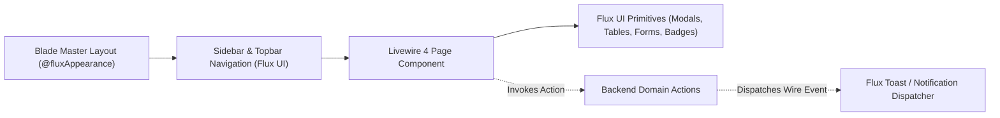

### 3.1 Standardized UI Patterns
- **Layouts**:
  - `layouts.app`: Master layout for hospital administration (sidebar navigation, quick search, user profile menu, dark mode toggle).
  - `layouts.guest`: Clean centered layout for login, password reset, and public portals.
  - `layouts.kiosk`: Specialized touch-friendly interface for on-site attendance kiosks and mobile web check-in.
- **Form Handling & Validation**: Livewire form objects encapsulation (`Flux::input`, `Flux::select`, `Flux::date-picker`) with real-time blur/debounce validation mapped directly to backend Form Request rules.
- **Table Data Grids**: Server-side paginated tables with deferred query searching, sortable column headers, badge status indicators, and bulk action drawers.
- **Loading & Empty States**:
  - `wire:loading` transitions with skeletal placeholders (`flux:skeleton`).
  - Standardized empty states with descriptive illustrations and actionable call-to-actions.
- **Authorization-Aware UI**:
  - Blade `@can` directives conditionally hide or disable UI elements (e.g. "Finalize Payroll" button).
  - **Rule**: Frontend hiding is strictly cosmetic; all backend Actions and Livewire endpoints enforce matching Policy assertions (`$this->authorize()`).

---

## 4. LARAVEL APPLICATION ARCHITECTURE

The application organizes domain logic using a Clean Domain-Action Architecture within Laravel conventions:

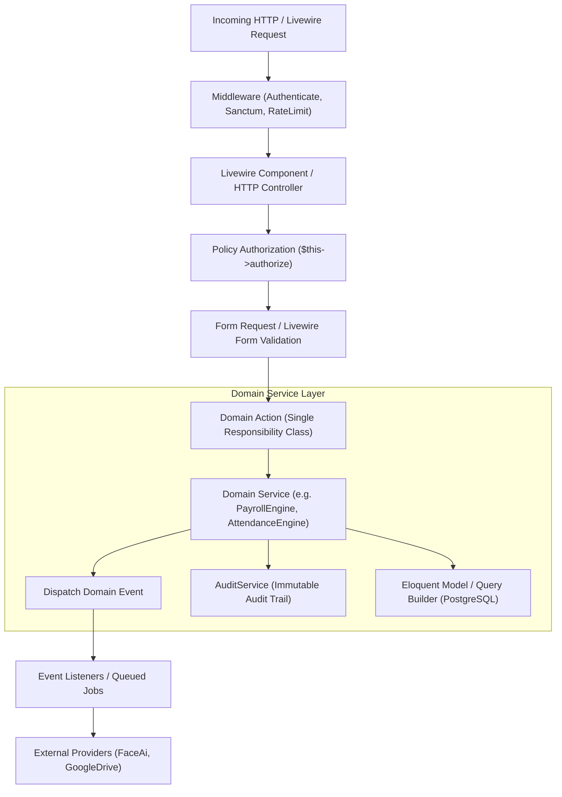

### 4.1 Responsibilities Matrix

| Architectural Layer | Location | Responsibilities | Constraints |
|---|---|---|---|
| **Models** | `app/Models` | Database schema mapping, Eloquent relations, casts, query scopes, and localized business getters. | No heavy business logic, no direct external API calls. |
| **Policies** | `app/Policies` | Granular permission gates matching user roles to resource actions. | Pure boolean evaluation. |
| **Actions** | `app/Actions/{Domain}` | Single-purpose invocable command classes executing specific domain state mutations (e.g., `FinalizePayrollAction`, `ProcessAttendanceEventAction`). | Every mutating user workflow must use an Action. |
| **Services** | `app/Services/{Domain}` | Reusable domain engines or external integrations (e.g., `PayrollCalculationService`, `DocumentService`, `AuditService`). | Interfaced via contracts when external dependencies exist. |
| **Form Requests** | `app/Http/Requests` | Input validation, type coercion, and authorized request parameter filtering. | No database updates. |
| **Jobs** | `app/Jobs/{Domain}` | Asynchronous background processing (Google Drive synchronization, report generation, batch email slips). | Must implement `ShouldQueue`, handle retries, and scrub sensitive payload data. |
| **Livewire Components** | `app/Livewire` | UI orchestration, view state management, wire event handling, and invocation of Actions. | No direct raw SQL queries; logic belongs in Actions. |

---

## 5. DOMAIN BOUNDARIES & DEPENDENCIES

The application is decomposed into 17 clear business domains:

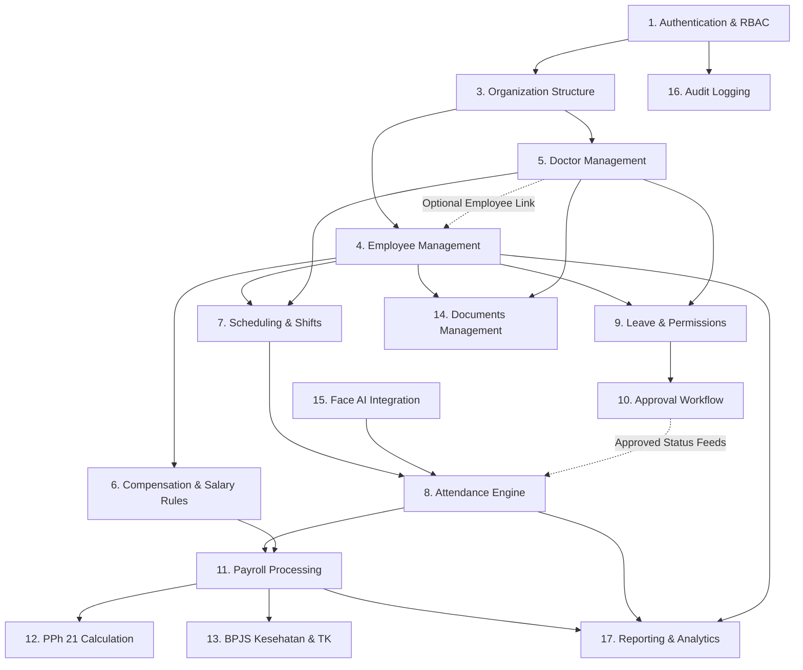

### 5.1 Domain Boundaries Specification

1. **Authentication & Identity**: User accounts, password policies, session security, multi-factor authentication (MFA), and API tokens (Sanctum).
2. **Authorization & RBAC**: Roles (Super Admin, HR Admin, HR Manager, Supervisor, Payroll, Finance, Doctor, Employee) and granular model Policies.
3. **Organization**: Hospital organization chart (Divisions, Departments, Units, Work Stations, Positions, Echelon tiers).
4. **Employee**: Core HR profile, bio data, employment contract history, educational background, family data, bank accounts, and employment status (Permanent, Contract, Probation, Intern).
5. **Doctor**: Specialized medical personnel directory, clinical credentials (STR, SIP, validity dates, issuing bodies), assigned Poly/Department. *Doctor may optionally link to Employee if on organic hospital payroll.*
6. **Compensation**: Effective-dated basic salaries, recurring allowances (positional, hazard, transport, night shift allowance), custom deduction templates.
7. **Scheduling & Shifts**: Shift definitions (morning, afternoon, night, long-shift, on-call), roster templates, department schedule assignments, rotation plans, and holiday calendars.
8. **Attendance Engine**: Multi-step verification: Device validation, Geofence GPS verification, Face AI verification, Schedule matching, Liveness checks, and Attendance Event logging.
9. **Leave & Permissions**: Leave entitlement balances (Annual, Sick, Maternity, Menstrual, Compassionate, Unpaid), application filing, medical certificate attachments.
10. **Approval Workflow**: Tiered approval hierarchy (Supervisor → Department Head → HR Manager) for leave, schedule overrides, manual attendance corrections, and payroll batches.
11. **Payroll Processing**: Component-based payroll generation: Period creation, Run initialization, Item generation, Earnings aggregation, Deductions processing, Finalization (immutable lock). *Jasa Medis is strictly excluded.*
12. **Tax (PPh 21)**: Indonesian income tax calculation based on effective regulatory schedules (TER PP 58/2023, PTKP categories TK/0 to K/3, annual reconciliation Form 1721-A1).
13. **BPJS Integration**: Regulatory BPJS Kesehatan (4% employer, 1% employee with wage cap) and BPJS Ketenagakerjaan (JKK, JKM, JHT, JP with statutory ceilings).
14. **Document Management**: Document metadata cataloging, secure categorization (`employees/ktp`, `doctors/str`), Google Drive storage abstraction, and temporary preview link generator.
15. **Face AI Integration**: External Face AI proxy service, feature vector extraction, 1:1 biometric similarity matching, and passive anti-spoofing liveness check.
16. **Audit Trail**: Append-only system-wide event logging recording Actor, Action, Resource, Context, and sanitized Old/New state snapshots.
17. **Reporting & Analytics**: Statutory reports, SPT PPh 21 export, bank payroll disbursement files (BCA, Mandiri, BNI formats), attendance summaries, and doctor credential expiration tracking.

---

## 6. DATABASE ARCHITECTURE (PostgreSQL)

### 6.1 Core Principles
- **Schema Engine**: PostgreSQL 16.
- **Primary Keys**:
  - `bigIncrements` (BIGINT) for high-frequency internal transactional tables (attendance events, audit logs, payroll items) for optimal B-Tree index traversal and cache footprint.
  - `uuid` (UUIDv4) for externally exposed public tokens, download URLs, and sensitive identifiers to mitigate enumeration attacks.
- **Referential Integrity**: Strict foreign keys across all relational boundaries with explicit `RESTRICT` on financial/auditable records and `SET NULL` on audit actors.
- **Audit Fields**: Every business table includes standard audit columns: `created_at`, `updated_at`, `created_by`, `updated_by`.
- **Soft Deletes**: Enabled on configuration, employee, doctor, and schedule tables (`deleted_at`). Financial and finalized payroll records **never** permit soft delete or physical delete.
- **Effective Dating**: Temporal tables (salary rates, BPJS percentages, allowances, tax brackets) implement `effective_from` and `effective_to` (nullable for active records) with overlapping date exclusion constraints.
- **JSONB Optimization**: Flexible configurations and audit snapshots utilize PostgreSQL `JSONB` columns with GIN indexing where key searchability is needed.

### 6.2 Transaction Boundaries
Database transactions (`DB::transaction(callback, attempts: 3)`) must encapsulate:
- Payroll Run calculation and batch item insertion.
- Attendance Event recording with biometric session closeout.
- Multi-tier Leave approval status transitions and entitlement balance deductions.
- Document upload and metadata persistence.

---

## 7. REDIS ARCHITECTURE

Redis 7 serves as the high-throughput, in-memory backbone:

1. **Queue Broker**: Primary queue driver (`QUEUE_CONNECTION=redis`) separated across dedicated priority tubes:
   - `high`: Authentication notifications, face verification streaming, synchronous UI alerts.
   - `default`: Document storage synchronization, attendance processing.
   - `low`: Batch payroll item calculations, heavy PDF report compiling, statutory exports.
2. **Cache Store**: Caching infrequently changing metadata (Hospital org units, system configuration, active shift rules, tax tables) using tagged caches (`Cache::tags(['org', 'shifts'])`).
3. **Distributed Locks**: Atomic locking (`Cache::lock('payroll-run-2026-10', 60)`) preventing race conditions during payroll execution, batch approval, or concurrent biometric enrollment.
4. **Rate Limiting**: IP-based and user-based throttling for authentication attempts, face verification endpoints, and document download requests (`ThrottleRequests` middleware).

---

## 8. QUEUE & BACKGROUND WORKER ARCHITECTURE

### 8.1 Queue Pipeline

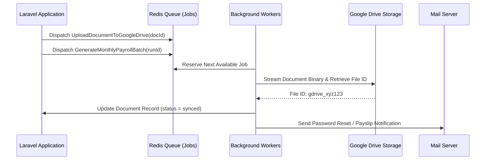

### 8.2 Failure & Retry Policy
- **Standard Jobs**: `tries = 3`, exponential backoff: `backoff = [10, 60, 300]`.
- **External Integration Jobs (Google Drive)**: `tries = 5`, exponential backoff with jitter to handle API rate limiting.
- **Poison Pill Mitigation**: Unrecoverable failures move to `failed_jobs` table; automated alerts triggered via log monitoring.
- **Data Scrubbing**: Job payloads must never serialize plain passwords, unhashed tokens, or raw biometric arrays.

---

## 9. GOOGLE DRIVE STORAGE ARCHITECTURE

### 9.1 Storage Abstraction Hierarchy

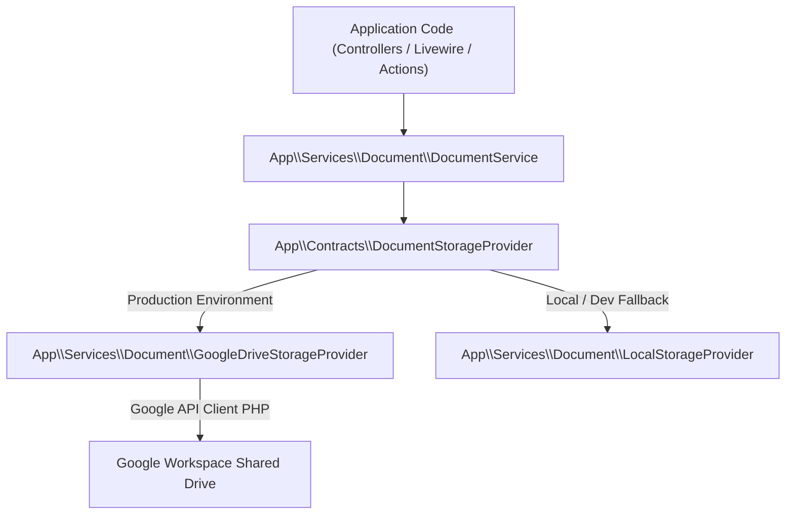

### 9.2 Folder Structure in Shared Drive
Documents stored in the Google Workspace Shared Drive adhere to an organized hierarchy:
```text
[Payroll_Juwita_Shared_Drive]/
├── employees/
│   ├── {employee_uuid}/
│   │   ├── ktp/
│   │   ├── kk/
│   │   ├── contracts/
│   │   └── certificates/
├── doctors/
│   ├── {doctor_uuid}/
│   │   ├── str/
│   │   ├── sip/
│   │   └── credentials/
├── attendance/
│   └── {YYYY-MM}/
│       └── evidence/
└── payroll/
    └── {YYYY-MM}/
        └── slips/
```

### 9.3 Operational Safeguards
- **Metadata Ownership**: The PostgreSQL database remains the single source of truth for file metadata (`id`, `uuid`, `original_name`, `mime_type`, `size_bytes`, `gdrive_file_id`, `category`, `uploaded_by`).
- **Access Authorization**: No direct public links are shared. Documents are accessed strictly through signed, time-limited application proxy URLs (`DocumentService::getPreviewUrl()`), enforcing Policy permissions before streaming.
- **Orphan File Prevention**: Deleting a record soft-deletes the database entry first; a queued job asynchronously removes the remote Google Drive file. If Google Drive fails, the job retries without holding the database transaction.

---

## 10. FACE AI SERVICE ARCHITECTURE

The Face AI engine is decoupled from Laravel, running as an independent internal service (e.g., Python FastAPI with InsightFace / ONNX Runtime).

### 10.1 Interaction Flow

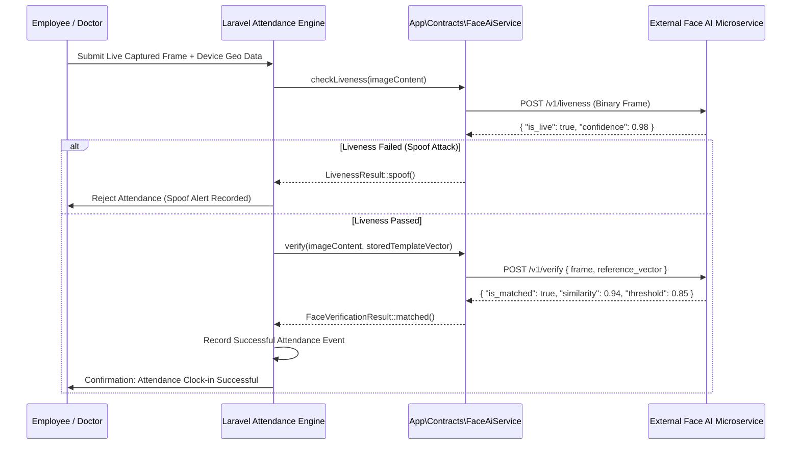

### 10.2 Service Boundaries & Privacy
- **Stateless AI Engine**: The Face AI microservice is completely stateless. It does not store employee names, roles, or raw images.
- **Secure Template Storage**: Raw biometric face images are **never** stored permanently after enrollment. Only 128-d or 512-d normalized floating-point numerical feature vectors are retained.
- **Encryption**: Biometric feature vectors are stored encrypted at rest (`encrypted` cast in PostgreSQL).
- **Service Security**: Communication between Laravel and the Face AI container occurs strictly over an internal Docker network protected by mTLS or high-entropy preshared secret header (`X-Face-AI-Secret`).

---

## 11. ATTENDANCE ENGINE ARCHITECTURE

### 11.1 Session State Machine

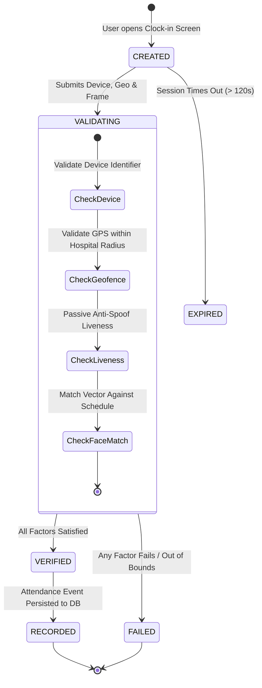

### 11.2 Multi-Factor Validation Criteria
1. **Identity & Device**: User authenticated via session; hardware fingerprint matches registered device profile.
2. **Geofence Validation**: Haversine distance calculation between client GPS coordinates and hospital perimeter (e.g., radius <= 100 meters). Mock/spoofed GPS flags rejected.
3. **Liveness Check**: Detection of photographic prints, digital screens, or 3D masks.
4. **Biometric Similarity**: Cosine similarity score >= system confidence threshold (e.g. 0.85).
5. **Roster Match**: Verification that the clock-in timestamp maps to an assigned shift or permitted flex window.
6. **Audit Trail**: Every attempt (success or failure) generates an immutable `attendance_logs` record including diagnostic flags for HR review.

---

## 12. LEAVE & APPROVAL WORKFLOW ARCHITECTURE

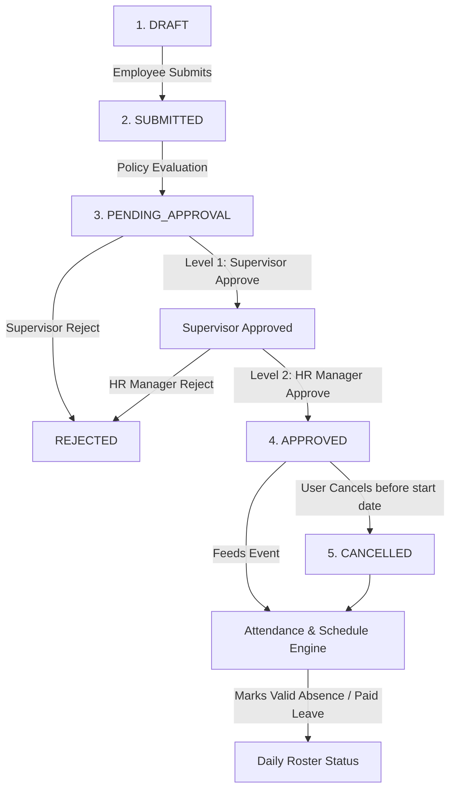

- **Domain Isolation**: Leave approval events dispatch domain events (`LeaveApprovedEvent`). The Attendance and Payroll domains consume these events without hard coupling to Leave controllers.
- **Entitlement Checks**: Balance deduction is handled using row-level database locking (`lockForUpdate()`) to prevent concurrent double-booking of annual leave days.

---

## 13. PAYROLL PROCESSING ARCHITECTURE

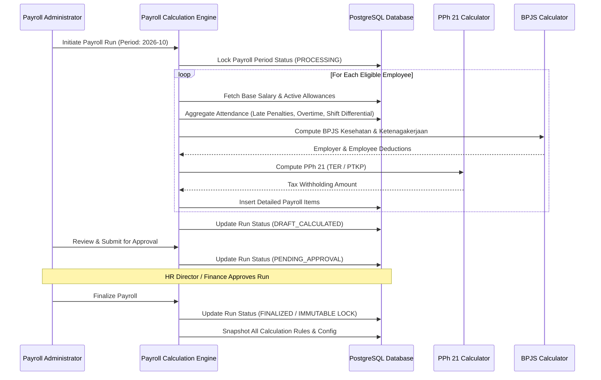

### 13.1 Immutability Rules
- Once a Payroll Run transitions to `FINALIZED`:
  - No records in `payroll_runs` or `payroll_items` can be updated or deleted. Database triggers / application policies reject any `UPDATE` or `DELETE` statement.
  - Corrections (e.g. retroactive attendance adjustment) are booked as an `ADJUSTMENT` item in the subsequent active period.

---

## 14. SECURITY ARCHITECTURE

### 14.1 Security Principles
- **Authentication**: Stateful sessions via encrypted cookies for web administration; Laravel Sanctum for kiosk/mobile API tokens.
- **Role-Based Access Control (RBAC)**: Enforced via native Laravel Policies. Strict checks on every controller, Livewire mount, and Action invocation.
- **IDOR Prevention**: All query scopes on employee and doctor documents must resolve through ownership policies (`$user->employee->id === $document->employee_id || $user->hasRole('HR Admin')`).
- **Data Protection at Rest**: Sensitive personally identifiable information (KTP number, bank account details) and biometric embeddings utilize Laravel attribute encryption (`casts => ['account_number' => 'encrypted']`).
- **Rate Limiting**: Tiered rate limiters in Redis for login (5 attempts/min), face verification (10 attempts/min), and sensitive exports.

---

## 15. BACKUP & DISASTER RECOVERY ARCHITECTURE

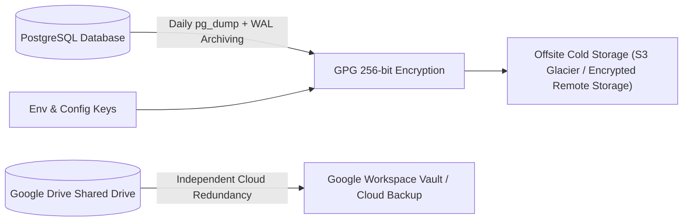

- **Database Backup**: Automated daily full snapshots (`pg_dump` with custom format) and continuous WAL (Write-Ahead Logging) archiving for Point-In-Time Recovery (PITR).
- **Encryption**: Backups are encrypted with AES-256 before transmission offsite.
- **Restore Testing**: Automated staging restore drills executed on a regular monthly schedule to verify backup archive integrity.

---

## 16. OBSERVABILITY & LOGGING

### 16.1 Log Classification
- **Application Logs (`laravel.log`)**: Standard framework execution, queue exceptions, and external API connection status.
- **Audit Logs (`audit_logs` DB table)**: Business state mutations (actor, resource, action, before/after values, IP, user-agent).
- **Security Logs**: Failed login spikes, geofence mismatch alerts, suspected face spoof attempts.
- **Health Checks**: Endpoint `/health` monitoring PostgreSQL connectivity, Redis latency, and Face AI service availability.

### 16.2 Log Redaction Rule
Under no circumstances may passwords, session tokens, authorization headers, raw face images, or biometric vector arrays appear in log files.

---

## 17. CONTAINERIZED DEPLOYMENT TOPOLOGY

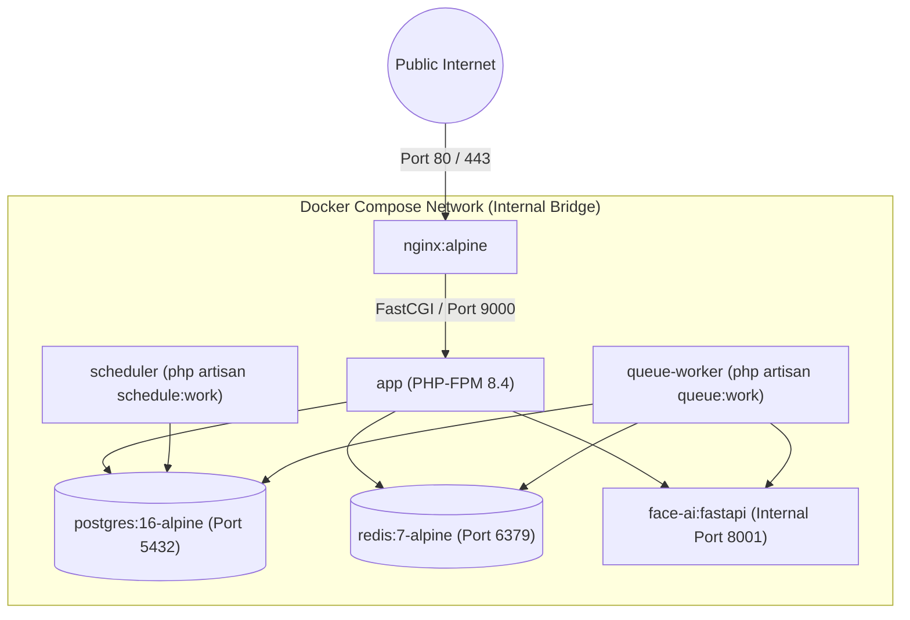

---

## 18. ARCHITECTURAL DECISION RECORDS (ADR)

### ADR-001: Single Hospital Scope
- **Decision**: Restrict application architecture exclusively to one hospital.
- **Reason**: Hospital HR, shift dynamics, and payroll are deeply specialized. Multi-tenancy adds significant schema overhead, accidental data-leak risks, and unwarranted complexity.
- **Alternatives Considered**: Multi-tenant database partitioning (separate schemas or tenant_id scoping).
- **Consequences**: Architecture is streamlined and performant; cannot be offered as a multi-tenant SaaS without architectural refactoring.

### ADR-002: Monolithic Laravel with Livewire 4
- **Decision**: Build as a modular monolith using Laravel 13 and Livewire 4.
- **Reason**: Minimizes maintenance burden, keeps business rules unified in PHP, and provides rapid UI responsiveness without API serialization overhead.
- **Alternatives Considered**: Separate SPA frontend (Vue/React) + REST/GraphQL API.
- **Consequences**: Eliminates frontend-backend state synchronization issues; mobile access requires responsive web / PWA approach rather than native mobile app SDKs.

### ADR-003: Flux UI v2 Component Library
- **Decision**: Adopt Flux UI v2 as the primary UI design system.
- **Reason**: Built natively for Livewire with accessibility, consistent typography, dark mode, and hospital-grade desktop data layouts.
- **Alternatives Considered**: Plain Tailwind components, Filament admin panel.
- **Consequences**: Fast, cohesive UI development; relies on Flux UI release lifecycle.

### ADR-004: PostgreSQL as Primary Relational Database
- **Decision**: Use PostgreSQL 16 as the sole relational database.
- **Reason**: Superior ACID support, reliable JSONB handling for flexible audit and rule storage, and powerful indexing.
- **Alternatives Considered**: MySQL 8.x, SQLite.
- **Consequences**: Full leverage of PostgreSQL-specific features; strict migration discipline required.

### ADR-005: Redis for Cache, Queue, and Locks
- **Decision**: Mandate Redis 7 for queue management, caching, and atomic locking.
- **Reason**: High-throughput in-memory performance preventing race conditions in attendance and payroll.
- **Alternatives Considered**: Database queue driver (`sync` / `database`).
- **Consequences**: Adds an operational container dependency; prevents database lock contention.

### ADR-006: Google Drive as Primary Document Storage
- **Decision**: Abstract object storage and integrate Google Workspace Shared Drive for employee and doctor credentials.
- **Reason**: The hospital uses Google Workspace; Shared Drives provide enterprise compliance, unlimited cloud storage, and internal governance.
- **Alternatives Considered**: AWS S3, MinIO, Local Disk storage.
- **Consequences**: Implementation encapsulated behind `DocumentStorageProvider` contract; requires handling Google API rate limits via queues.

### ADR-007: Isolated External Face AI Service
- **Decision**: Implement Face AI inference in a separate containerized microservice via a contract interface.
- **Reason**: Biometric vision models (Python/ONNX) do not belong in the PHP execution thread. Decoupling ensures Laravel remains stable, and models can be upgraded independently.
- **Alternatives Considered**: Third-party SaaS vision APIs (AWS Rekognition), running embedded C-bindings in PHP.
- **Consequences**: Zero recurring per-scan SaaS costs; self-hosted compute resources required for AI container.

### ADR-008: Strict Biometric Vector Protection & Template Deletion
- **Decision**: Permanently discard raw facial images after enrollment; store only encrypted mathematical feature vectors.
- **Reason**: Legal compliance, medical ethics, and employee biometric data privacy.
- **Alternatives Considered**: Storing raw captured enrollment photos in storage.
- **Consequences**: Inability to reconstruct the original face image if the model is changed (requires re-enrollment if vector representation changes).

### ADR-009: Multi-Factor Attendance Verification Pipeline
- **Decision**: Validate attendance through an ordered pipeline: Device + Geofence + Liveness + Face Match + Schedule.
- **Reason**: Biometrics alone can be spoofed; GPS alone can be spoofed. Multi-factor validation ensures unimpeachable audit proof.
- **Alternatives Considered**: Standalone RFID badge scanners, single-factor GPS check-in.
- **Consequences**: Requires users to grant camera and location permissions on check-in devices.

### ADR-010: Immutable Finalized Payroll
- **Decision**: Lock finalized payroll records permanently against mutation or deletion.
- **Reason**: Legal, taxation, and financial compliance. Historical payroll audits require 100% reproducibility.
- **Alternatives Considered**: Allowing super admins to edit finalized records.
- **Consequences**: Corrections require generating explicit adjustment line-items in subsequent pay periods.

---

## 19. ARCHITECTURAL SUMMARY & DEPENDENCIES

### 19.1 Key Architectural Components
1. **Application Monolith**: Laravel 13, Livewire 4, Flux UI v2, Tailwind CSS 4.
2. **Infrastructure**: PostgreSQL 16 (Data), Redis 7 (Cache/Queue/Locks), Nginx (Reverse Proxy).
3. **Dedicated Services**: Face AI Container (FastAPI/ONNX), Google Drive API Integration.
4. **Foundation Contracts**: `FaceAiService`, `DocumentStorageProvider`, `AuditService`.

### 19.2 Major Security Boundaries
- **External Network vs. Internal Network**: Only Nginx (80/443) is exposed to clients. PostgreSQL, Redis, and Face AI containers are isolated on internal Docker networks.
- **Biometric Isolation**: Biometric templates stored encrypted at rest; Face AI microservice communicates only with the Laravel application container.
- **File Access Security**: Google Drive files are inaccessible directly; all access is mediated through authorized, signed temporary application URLs.
- **Data Mutation Integrity**: Role-Based Policies guard all Actions; AuditService records all state changes with automatic redaction of credentials and biometrics.

### 19.3 Dependencies on Subsequent Database Design (`/docs/03-database.md`)
The database schema design must implement:
1. **Normalized Entity Separation**: Distinct `employees` and `doctors` tables with an optional nullable foreign key `doctors.employee_id`.
2. **Effective-Dated Records**: `effective_from` and `effective_to` columns on `salary_records`, `allowance_templates`, `bpjs_rates`, and `tax_brackets`.
3. **Immutable Structure**: `payroll_runs` and `payroll_items` structured to support an `is_finalized` flag with strict constraints against updates once locked.
4. **Multi-Factor Attendance Logs**: `attendance_events` table supporting geolocation coordinates, device fingerprints, verification confidence scores, and relation to assigned work schedules.
