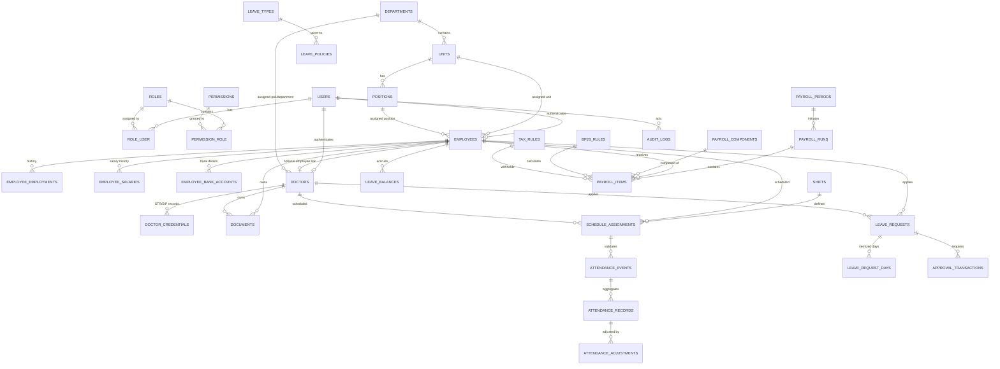

# DATABASE ARCHITECTURE & RELATIONAL ERD SPECIFICATION

**Document Identifier**: `/docs/03-database.md`  
**System Name**: Hospital Human Resources, Payroll, Attendance, and Doctor Scheduling System  
**Database Engine**: PostgreSQL 16  
**Target Organization**: Single Hospital Enterprise Deployment (Juwita Hospital)  
**Role**: Senior Database Architect  
**Status**: APPROVED DATABASE ARCHITECTURE BASELINE  

---

## 1. DATABASE GOALS & PHILOSOPHY

The database is designed to serve as the unified, highly auditable transactional record for a single hospital. It enforces referential integrity, strong data types, temporal tracking (effective dating), and strict financial immutability.

### Core Architectural Guarantees:
1. **Single-Tenant Relational Model**: No `tenant_id` columns, partition schemes, or multi-tenant complexity.
2. **Normalized Core HR**: Primary normalization to Third Normal Form (3NF). Controlled denormalization is permitted only on finalized payroll snapshots for audit compliance and performance.
3. **Temporal Integrity (Effective Dating)**: Historical salaries, employment contracts, allowance rules, BPJS brackets, and tax rates preserve full historical validity via `effective_from` and `effective_to` date ranges. Prior rates are never overwritten.
4. **Immutability of Financial Records**: Once a payroll run reaches `FINALIZED`, row-level database triggers and application policies strictly forbid `UPDATE` and `DELETE` operations.
5. **Decoupled Biometrics**: Biometric templates are stored as encrypted mathematical feature vectors. Raw face images are never stored in the database.

---

## 2. PRIMARY KEYS & IDENTIFIER STRATEGY

The database adopts a **Hybrid Identifier Strategy**:

| Column Pattern | Data Type | Usage Context | Rationale |
|---|---|---|---|
| `id` | `BIGINT GENERATED ALWAYS AS IDENTITY` | Internal primary keys, relational foreign keys, high-frequency transactional tables (`attendance_events`, `audit_logs`, `payroll_items`). | Optimal 64-bit integer indexing, high B-Tree traversal performance, minimal storage footprint, and seamless sequence generation in PostgreSQL. |
| `uuid` | `UUID` (v4, Indexed, Unique) | Publicly exposed entities (`employees`, `doctors`, `documents`, `leave_requests`, `payroll_runs`). | Eliminates ID enumeration (IDOR) attacks, protects employee IDs, and enables secure presigned document download tokens. |

---

## 3. MONETARY DATA TYPE & ROUNDING STANDARDS

- **Type**: `NUMERIC(15, 2)` (Standard Indonesian Rupiah currency with fractional support for precision prorations and statutory tax percentages).
- **Scale & Precision**: 15 digits total with 2 decimal places (supports values up to Rp 9,999,999,999,999.99).
- **Rounding Strategy**:
  - Intermediate calculations (hourly proration, BPJS percentages) retain full floating precision.
  - Final itemized payroll and tax withholding amounts apply **Banker's Rounding (Round Half to Even)** rounded to the nearest integer Rupiah (`NUMERIC(15, 0)` on net disbursement).
- **Constraints**: All salary, allowance, and net pay columns enforce non-negative check constraints: `CHECK (amount >= 0)`.

---

## 4. TEMPORAL / EFFECTIVE DATING PATTERN

Temporal tables implement effective dating using:
- `effective_from DATE NOT NULL`
- `effective_to DATE NULL` (NULL indicates the currently active record)

### Active Record Query Pattern:
```sql
SELECT * FROM employee_salaries 
WHERE employee_id = :id 
  AND effective_from <= :target_date 
  AND (effective_to IS NULL OR effective_to >= :target_date);
```

### Overlap Exclusion Constraint:
PostgreSQL `btree_gist` extension is utilized to prevent overlapping effective date ranges for the same entity:
```sql
ALTER TABLE employee_salaries 
ADD CONSTRAINT exclude_overlapping_salaries 
EXCLUDE USING gist (
  employee_id WITH =,
  daterange(effective_from, COALESCE(effective_to, 'infinity'::date), '[]') WITH &&
);
```

---

## 5. COMPLETE ENTITY RELATIONSHIP DIAGRAM (MERMAID ERD)



---

## 6. DATA DICTIONARY & TABLE SPECIFICATIONS

### 6.1 Authentication & Authorization Domain

#### 1. `users`
*Purpose*: User account credentials and core authentication identity.*
- `id` (BIGINT, PK, Identity): Primary auto-increment identifier.
- `uuid` (UUID, Unique, NOT NULL): Public unique identifier.
- `name` (VARCHAR(150), NOT NULL): Full user display name.
- `email` (VARCHAR(150), Unique, NOT NULL): Official login email address.
- `password` (VARCHAR(255), NOT NULL): Hashed password (Bcrypt).
- `is_active` (BOOLEAN, NOT NULL, DEFAULT true): Active account flag.
- `remember_token` (VARCHAR(100), NULL): Session remember token.
- `created_at` (TIMESTAMP, NOT NULL, useCurrent()).
- `updated_at` (TIMESTAMP, NOT NULL, useCurrent()).

#### 2. `roles`
*Purpose*: System access roles (Super Admin, HR Admin, HR Manager, Supervisor, Payroll, Finance, Doctor, Employee).*
- `id` (BIGINT, PK, Identity).
- `name` (VARCHAR(50), Unique, NOT NULL): Internal slug (`hr_manager`).
- `display_name` (VARCHAR(100), NOT NULL): Display label ("HR Manager").
- `description` (TEXT, NULL).
- `created_at` (TIMESTAMP, NOT NULL).
- `updated_at` (TIMESTAMP, NOT NULL).

#### 3. `permissions`
*Purpose*: Granular action permissions matching `domain.action` format.*
- `id` (BIGINT, PK, Identity).
- `name` (VARCHAR(100), Unique, NOT NULL): E.g. `payroll.finalize`.
- `module` (VARCHAR(50), NOT NULL): Domain grouping (`payroll`, `attendance`).
- `description` (TEXT, NULL).
- `created_at` (TIMESTAMP, NOT NULL).

#### 4. `role_user`
*Purpose*: User to Role assignment.*
- `user_id` (BIGINT, FK -> users.id, ON DELETE CASCADE, PK).
- `role_id` (BIGINT, FK -> roles.id, ON DELETE CASCADE, PK).

#### 5. `permission_role`
*Purpose*: Role to Permission mapping.*
- `role_id` (BIGINT, FK -> roles.id, ON DELETE CASCADE, PK).
- `permission_id` (BIGINT, FK -> permissions.id, ON DELETE CASCADE, PK).

---

### 6.2 Organization Domain

#### 6. `departments`
*Purpose*: Top-level hospital organizational divisions (Medical, Nursing, General Affairs, Finance).*
- `id` (BIGINT, PK, Identity).
- `code` (VARCHAR(20), Unique, NOT NULL): Code identifier (`DEPT-MED`).
- `name` (VARCHAR(100), NOT NULL): Department name.
- `parent_id` (BIGINT, FK -> departments.id, NULL, ON DELETE RESTRICT): Hierarchy parent.
- `is_active` (BOOLEAN, NOT NULL, DEFAULT true).
- `created_at`, `updated_at`.

#### 7. `units`
*Purpose*: Operational wards, clinics, and work stations (ICU, Emergency, Outpatient Poli, Hemodialysis).*
- `id` (BIGINT, PK, Identity).
- `department_id` (BIGINT, FK -> departments.id, NOT NULL, ON DELETE RESTRICT).
- `code` (VARCHAR(20), Unique, NOT NULL): Unit code (`UNIT-ICU`).
- `name` (VARCHAR(100), NOT NULL): Unit name.
- `is_active` (BOOLEAN, NOT NULL, DEFAULT true).
- `created_at`, `updated_at`.

#### 8. `positions`
*Purpose*: Standardized job positions and organizational titles.*
- `id` (BIGINT, PK, Identity).
- `unit_id` (BIGINT, FK -> units.id, NULL, ON DELETE RESTRICT).
- `title` (VARCHAR(100), NOT NULL): Position title ("Head Nurse", "Staff Radiographer").
- `grade_level` (VARCHAR(20), NOT NULL): Grading hierarchy ("Echelon IV", "Staff").
- `created_at`, `updated_at`.

#### 9. `holidays`
*Purpose*: Hospital public holiday calendar and mandatory collective leave days.*
- `id` (BIGINT, PK, Identity).
- `holiday_date` (DATE, Unique, NOT NULL): Date of holiday.
- `name` (VARCHAR(100), NOT NULL): Holiday designation.
- `is_collective_leave` (BOOLEAN, NOT NULL, DEFAULT false): Cuti bersama flag.
- `created_at`, `updated_at`.

---

### 6.3 Employee Domain

#### 10. `employees`
*Purpose*: Primary hospital personnel profile.*
- `id` (BIGINT, PK, Identity).
- `uuid` (UUID, Unique, NOT NULL).
- `user_id` (BIGINT, FK -> users.id, Unique, NULL, ON DELETE SET NULL): Optional user link.
- `unit_id` (BIGINT, FK -> units.id, NOT NULL, ON DELETE RESTRICT).
- `position_id` (BIGINT, FK -> positions.id, NOT NULL, ON DELETE RESTRICT).
- `nip` (VARCHAR(30), Unique, NOT NULL): Nomor Induk Pegawai.
- `ktp_number` (VARCHAR(255), NOT NULL): Encrypted NIK KTP.
- `full_name` (VARCHAR(150), NOT NULL): Full legal name.
- `gender` (VARCHAR(10), NOT NULL, CHECK: `gender IN ('male', 'female')`).
- `birth_place` (VARCHAR(100), NOT NULL).
- `birth_date` (DATE, NOT NULL).
- `marital_status` (VARCHAR(20), NOT NULL): Single, Married, Divorced.
- `tax_dependents` (SMALLINT, NOT NULL, DEFAULT 0, CHECK: `>= 0 AND <= 3`): PTKP dependents.
- `npwp_number` (VARCHAR(50), NULL): Tax ID.
- `phone_number` (VARCHAR(30), NOT NULL).
- `residential_address` (TEXT, NOT NULL).
- `face_biometric_vector` (TEXT, NULL): Encrypted 128-d/512-d feature vector array.
- `status` (VARCHAR(20), NOT NULL, DEFAULT 'active', CHECK: `status IN ('active', 'suspended', 'terminated', 'resigned')`).
- `created_at`, `updated_at`, `deleted_at`.

#### 11. `employee_employments`
*Purpose*: Effective-dated employment contract records (PKWT, PKWTT, Internship).*
- `id` (BIGINT, PK, Identity).
- `employee_id` (BIGINT, FK -> employees.id, NOT NULL, ON DELETE RESTRICT).
- `contract_type` (VARCHAR(20), NOT NULL, CHECK: `contract_type IN ('permanent', 'contract', 'probation', 'internship')`).
- `contract_number` (VARCHAR(100), NOT NULL).
- `start_date` (DATE, NOT NULL).
- `end_date` (DATE, NULL): NULL for permanent employees.
- `is_active` (BOOLEAN, NOT NULL, DEFAULT true).
- `created_at`, `updated_at`.

#### 12. `employee_salaries`
*Purpose*: Effective-dated basic salary history.*
- `id` (BIGINT, PK, Identity).
- `employee_id` (BIGINT, FK -> employees.id, NOT NULL, ON DELETE RESTRICT).
- `basic_salary` (NUMERIC(15, 2), NOT NULL, CHECK: `basic_salary >= 0`).
- `effective_from` (DATE, NOT NULL).
- `effective_to` (DATE, NULL).
- `revision_reason` (VARCHAR(255), NOT NULL): E.g., "Annual Promotion 2026".
- `created_by` (BIGINT, FK -> users.id, NOT NULL).
- `created_at`, `updated_at`.

#### 13. `employee_bank_accounts`
*Purpose*: Employee salary disbursement bank accounts.*
- `id` (BIGINT, PK, Identity).
- `employee_id` (BIGINT, FK -> employees.id, NOT NULL, ON DELETE RESTRICT).
- `bank_name` (VARCHAR(50), NOT NULL): BCA, Mandiri, BNI, BRI.
- `account_number` (VARCHAR(255), NOT NULL): Encrypted account number.
- `account_holder` (VARCHAR(150), NOT NULL).
- `is_primary` (BOOLEAN, NOT NULL, DEFAULT true).
- `created_at`, `updated_at`.

---

### 6.4 Doctor Domain

#### 14. `doctors`
*Purpose*: Dedicated physician registry with independent credentials.*
- `id` (BIGINT, PK, Identity).
- `uuid` (UUID, Unique, NOT NULL).
- `user_id` (BIGINT, FK -> users.id, Unique, NULL, ON DELETE SET NULL).
- `employee_id` (BIGINT, FK -> employees.id, Unique, NULL, ON DELETE SET NULL): Optional link if on hospital payroll.
- `department_id` (BIGINT, FK -> departments.id, NOT NULL, ON DELETE RESTRICT): Assigned Poly/Division.
- `doctor_code` (VARCHAR(30), Unique, NOT NULL): Doctor identification code.
- `full_name_with_title` (VARCHAR(150), NOT NULL): E.g. "dr. Juwita, Sp.A".
- `specialization` (VARCHAR(100), NOT NULL): Pediatrics, Cardiology, General Practitioner.
- `phone_number` (VARCHAR(30), NOT NULL).
- `email` (VARCHAR(150), NOT NULL).
- `status` (VARCHAR(20), NOT NULL, DEFAULT 'active', CHECK: `status IN ('active', 'inactive')`).
- `created_at`, `updated_at`, `deleted_at`.

#### 15. `doctor_credentials`
*Purpose*: Clinical license tracking (STR and SIP) with expiration vigilance.*
- `id` (BIGINT, PK, Identity).
- `doctor_id` (BIGINT, FK -> doctors.id, NOT NULL, ON DELETE CASCADE).
- `credential_type` (VARCHAR(10), NOT NULL, CHECK: `credential_type IN ('STR', 'SIP')`).
- `registration_number` (VARCHAR(100), NOT NULL).
- `issuing_authority` (VARCHAR(150), NOT NULL): KKI, Dinas Kesehatan.
- `valid_from` (DATE, NOT NULL).
- `valid_to` (DATE, NOT NULL).
- `created_at`, `updated_at`.

---

### 6.5 Document Domain

#### 16. `documents`
*Purpose*: Generic document metadata catalog linked to Google Workspace Shared Drive.*
- `id` (BIGINT, PK, Identity).
- `uuid` (UUID, Unique, NOT NULL).
- `documentable_type` (VARCHAR(100), NOT NULL): Polymorphic (`App\Models\Employee`, `App\Models\Doctor`).
- `documentable_id` (BIGINT, NOT NULL).
- `category` (VARCHAR(50), NOT NULL): `ktp`, `str`, `sip`, `contract`, `ijazah`, `payslip`.
- `original_filename` (VARCHAR(255), NOT NULL).
- `mime_type` (VARCHAR(100), NOT NULL).
- `size_bytes` (INTEGER, NOT NULL).
- `storage_provider` (VARCHAR(30), NOT NULL, DEFAULT 'google_drive').
- `google_drive_file_id` (VARCHAR(255), NOT NULL).
- `uploaded_by` (BIGINT, FK -> users.id, NOT NULL).
- `created_at`, `updated_at`, `deleted_at`.

---

### 6.6 Scheduling & Shifts Domain

#### 17. `shifts`
*Purpose*: Hospital shift master definitions.*
- `id` (BIGINT, PK, Identity).
- `code` (VARCHAR(20), Unique, NOT NULL): `PAGI`, `SIANG`, `MALAM`, `ON_CALL`.
- `name` (VARCHAR(50), NOT NULL): Shift name.
- `start_time` (TIME, NOT NULL): Shift commencement.
- `end_time` (TIME, NOT NULL): Shift termination.
- `crosses_midnight` (BOOLEAN, NOT NULL, DEFAULT false): True for overnight shifts.
- `grace_period_minutes` (SMALLINT, NOT NULL, DEFAULT 15): Lateness grace threshold.
- `is_active` (BOOLEAN, NOT NULL, DEFAULT true).
- `created_at`, `updated_at`.

#### 18. `schedule_assignments`
*Purpose*: Daily scheduled shifts for employees and doctors.*
- `id` (BIGINT, PK, Identity).
- `schedulable_type` (VARCHAR(100), NOT NULL): Polymorphic (`App\Models\Employee`, `App\Models\Doctor`).
- `schedulable_id` (BIGINT, NOT NULL).
- `shift_id` (BIGINT, FK -> shifts.id, NOT NULL, ON DELETE RESTRICT).
- `schedule_date` (DATE, NOT NULL).
- `is_published` (BOOLEAN, NOT NULL, DEFAULT false).
- `published_by` (BIGINT, FK -> users.id, NULL).
- `created_at`, `updated_at`.
- *Constraint*: `UNIQUE (schedulable_type, schedulable_id, schedule_date)` prevents duplicate shifts.

---

### 6.7 Attendance Engine Domain

#### 19. `attendance_events`
*Purpose*: Raw biometric and geofenced check-in / check-out evidence stream.*
- `id` (BIGINT, PK, Identity).
- `schedule_assignment_id` (BIGINT, FK -> schedule_assignments.id, NULL, ON DELETE SET NULL).
- `user_id` (BIGINT, FK -> users.id, NOT NULL).
- `event_type` (VARCHAR(10), NOT NULL, CHECK: `event_type IN ('in', 'out')`).
- `captured_at` (TIMESTAMP, NOT NULL, useCurrent()).
- `latitude` (NUMERIC(10, 7), NOT NULL).
- `longitude` (NUMERIC(10, 7), NOT NULL).
- `distance_meters` (NUMERIC(8, 2), NOT NULL): Distance from hospital center.
- `is_within_geofence` (BOOLEAN, NOT NULL).
- `device_fingerprint` (VARCHAR(255), NOT NULL).
- `liveness_score` (NUMERIC(4, 3), NOT NULL): Score from 0.000 to 1.000.
- `similarity_score` (NUMERIC(4, 3), NOT NULL): Score from 0.000 to 1.000.
- `verification_status` (VARCHAR(20), NOT NULL, CHECK: `verification_status IN ('verified', 'flagged', 'rejected')`).
- `created_at` (TIMESTAMP, NOT NULL, useCurrent()).

#### 20. `attendance_records`
*Purpose*: Daily aggregated attendance record feeding payroll.*
- `id` (BIGINT, PK, Identity).
- `schedule_assignment_id` (BIGINT, FK -> schedule_assignments.id, Unique, NOT NULL).
- `check_in_event_id` (BIGINT, FK -> attendance_events.id, NULL).
- `check_out_event_id` (BIGINT, FK -> attendance_events.id, NULL).
- `status` (VARCHAR(20), NOT NULL, CHECK: `status IN ('present', 'late', 'early_leave', 'absent', 'on_leave', 'holiday')`).
- `late_minutes` (INTEGER, NOT NULL, DEFAULT 0).
- `early_leave_minutes` (INTEGER, NOT NULL, DEFAULT 0).
- `work_duration_minutes` (INTEGER, NOT NULL, DEFAULT 0).
- `overtime_minutes` (INTEGER, NOT NULL, DEFAULT 0).
- `is_locked` (BOOLEAN, NOT NULL, DEFAULT false): Locked upon payroll calculation.
- `created_at`, `updated_at`.

#### 21. `attendance_adjustments`
*Purpose*: Auditable manual corrections to attendance.*
- `id` (BIGINT, PK, Identity).
- `attendance_record_id` (BIGINT, FK -> attendance_records.id, NOT NULL).
- `requested_by` (BIGINT, FK -> users.id, NOT NULL).
- `approved_by` (BIGINT, FK -> users.id, NULL).
- `old_status` (VARCHAR(20), NOT NULL).
- `new_status` (VARCHAR(20), NOT NULL).
- `adjustment_reason` (TEXT, NOT NULL).
- `status` (VARCHAR(20), NOT NULL, CHECK: `status IN ('pending', 'approved', 'rejected')`).
- `created_at`, `updated_at`.

---

### 6.8 Leave & Approval Domain

#### 22. `leave_types`
*Purpose*: Master categories of permissible absences.*
- `id` (BIGINT, PK, Identity).
- `code` (VARCHAR(20), Unique, NOT NULL): `ANNUAL`, `SICK`, `MATERNITY`, `UNPAID`.
- `name` (VARCHAR(100), NOT NULL).
- `requires_attachment` (BOOLEAN, NOT NULL, DEFAULT false): True for medical certificates.
- `deducts_quota` (BOOLEAN, NOT NULL, DEFAULT true).
- `created_at`, `updated_at`.

#### 23. `leave_balances`
*Purpose*: Employee annual entitlement ledger.*
- `id` (BIGINT, PK, Identity).
- `employee_id` (BIGINT, FK -> employees.id, NOT NULL, ON DELETE CASCADE).
- `leave_type_id` (BIGINT, FK -> leave_types.id, NOT NULL, ON DELETE RESTRICT).
- `year` (SMALLINT, NOT NULL).
- `entitled_days` (NUMERIC(4, 1), NOT NULL): E.g. 12.0 days.
- `used_days` (NUMERIC(4, 1), NOT NULL, DEFAULT 0.0).
- `remaining_days` (NUMERIC(4, 1), GENERATED ALWAYS AS (entitled_days - used_days) STORED).
- `created_at`, `updated_at`.
- *Constraint*: `UNIQUE (employee_id, leave_type_id, year)`.

#### 24. `leave_requests`
*Purpose*: Leave application header.*
- `id` (BIGINT, PK, Identity).
- `uuid` (UUID, Unique, NOT NULL).
- `applicant_type` (VARCHAR(100), NOT NULL): Polymorphic (`App\Models\Employee`, `App\Models\Doctor`).
- `applicant_id` (BIGINT, NOT NULL).
- `leave_type_id` (BIGINT, FK -> leave_types.id, NOT NULL).
- `start_date` (DATE, NOT NULL).
- `end_date` (DATE, NOT NULL).
- `total_days` (NUMERIC(4, 1), NOT NULL).
- `reason` (TEXT, NOT NULL).
- `attachment_document_id` (BIGINT, FK -> documents.id, NULL).
- `status` (VARCHAR(20), NOT NULL, CHECK: `status IN ('draft', 'submitted', 'pending_approval', 'approved', 'rejected', 'cancelled')`).
- `created_at`, `updated_at`.

#### 25. `leave_request_days`
*Purpose*: Breakdown of individual calendar days covered by a leave request.*
- `id` (BIGINT, PK, Identity).
- `leave_request_id` (BIGINT, FK -> leave_requests.id, NOT NULL, ON DELETE CASCADE).
- `date` (DATE, NOT NULL).
- `is_workday` (BOOLEAN, NOT NULL, DEFAULT true).

#### 26. `approval_transactions`
*Purpose*: Multi-stage approval routing for leaves, adjustments, and payroll.*
- `id` (BIGINT, PK, Identity).
- `approvable_type` (VARCHAR(100), NOT NULL): Polymorphic.
- `approvable_id` (BIGINT, NOT NULL).
- `approver_id` (BIGINT, FK -> users.id, NOT NULL).
- `step_number` (SMALLINT, NOT NULL, DEFAULT 1): Tier 1, Tier 2.
- `action` (VARCHAR(20), NOT NULL, CHECK: `action IN ('approved', 'rejected')`).
- `comment` (TEXT, NULL).
- `action_at` (TIMESTAMP, NOT NULL, useCurrent()).

---

### 6.9 Payroll & Compensation Domain

#### 27. `payroll_periods`
*Purpose*: Standardized payroll cycle calendar definition.*
- `id` (BIGINT, PK, Identity).
- `name` (VARCHAR(50), Unique, NOT NULL): E.g. "October 2026".
- `cutoff_start_date` (DATE, NOT NULL): E.g. 2026-09-21.
- `cutoff_end_date` (DATE, NOT NULL): E.g. 2026-10-20.
- `payment_date` (DATE, NOT NULL): E.g. 2026-10-25.
- `created_at`, `updated_at`.

#### 28. `payroll_runs`
*Purpose*: The execution container for monthly payroll calculation.*
- `id` (BIGINT, PK, Identity).
- `uuid` (UUID, Unique, NOT NULL).
- `payroll_period_id` (BIGINT, FK -> payroll_periods.id, NOT NULL).
- `run_date` (TIMESTAMP, NOT NULL, useCurrent()).
- `status` (VARCHAR(20), NOT NULL, CHECK: `status IN ('draft', 'processing', 'calculated', 'pending_approval', 'approved', 'finalized', 'void')`).
- `total_gross` (NUMERIC(15, 2), NOT NULL, DEFAULT 0.00).
- `total_deductions` (NUMERIC(15, 2), NOT NULL, DEFAULT 0.00).
- `total_net` (NUMERIC(15, 2), NOT NULL, DEFAULT 0.00).
- `finalized_by` (BIGINT, FK -> users.id, NULL).
- `finalized_at` (TIMESTAMP, NULL).
- `created_at`, `updated_at`.

#### 29. `payroll_components`
*Purpose*: Reusable earnings and deduction catalog.*
- `id` (BIGINT, PK, Identity).
- `code` (VARCHAR(30), Unique, NOT NULL): `BASIC`, `HAZARD_ALLOWANCE`, `NIGHT_SHIFT`, `BPJS_KES_EE`, `PPH21`.
- `name` (VARCHAR(100), NOT NULL).
- `type` (VARCHAR(15), NOT NULL, CHECK: `type IN ('earning', 'deduction')`).
- `is_taxable` (BOOLEAN, NOT NULL, DEFAULT true).
- `created_at`, `updated_at`.

#### 30. `payroll_items`
*Purpose*: Itemized gross-to-net breakdown per employee in a payroll run (Immutable upon run finalization).*
- `id` (BIGINT, PK, Identity).
- `payroll_run_id` (BIGINT, FK -> payroll_runs.id, NOT NULL, ON DELETE RESTRICT).
- `employee_id` (BIGINT, FK -> employees.id, NOT NULL, ON DELETE RESTRICT).
- `payroll_component_id` (BIGINT, FK -> payroll_components.id, NOT NULL, ON DELETE RESTRICT).
- `amount` (NUMERIC(15, 2), NOT NULL).
- `calculation_notes` (VARCHAR(255), NULL): Audit formula description.
- `created_at` (TIMESTAMP, NOT NULL, useCurrent()).

---

### 6.10 Statutory BPJS & PPh 21 Tax Domain

#### 31. `bpjs_programs`
*Purpose*: Master catalog of statutory BPJS programs.*
- `id` (BIGINT, PK, Identity).
- `code` (VARCHAR(20), Unique, NOT NULL): `BPJS_KES`, `JKK`, `JKM`, `JHT`, `JP`.
- `name` (VARCHAR(100), NOT NULL).
- `created_at`, `updated_at`.

#### 32. `bpjs_rules`
*Purpose*: Effective-dated statutory BPJS rates and contribution ceilings.*
- `id` (BIGINT, PK, Identity).
- `bpjs_program_id` (BIGINT, FK -> bpjs_programs.id, NOT NULL).
- `employer_rate_percent` (NUMERIC(5, 2), NOT NULL): E.g. 4.00%.
- `employee_rate_percent` (NUMERIC(5, 2), NOT NULL): E.g. 1.00%.
- `salary_cap_ceiling` (NUMERIC(15, 2), NULL): Max wage ceiling (e.g. 12,000,000 for Health).
- `salary_floor` (NUMERIC(15, 2), NULL): UMK base floor.
- `effective_from` (DATE, NOT NULL).
- `effective_to` (DATE, NULL).
- `created_at`, `updated_at`.

#### 33. `tax_rules`
*Purpose*: Effective-dated PPh 21 tax schedules (TER PP 58/2023 & Annual PTKP).*
- `id` (BIGINT, PK, Identity).
- `ter_category` (VARCHAR(5), NOT NULL, CHECK: `ter_category IN ('A', 'B', 'C')`).
- `gross_range_min` (NUMERIC(15, 2), NOT NULL).
- `gross_range_max` (NUMERIC(15, 2), NOT NULL).
- `rate_percent` (NUMERIC(5, 2), NOT NULL): Progressive rate percentage.
- `effective_from` (DATE, NOT NULL).
- `effective_to` (DATE, NULL).
- `created_at`, `updated_at`.

---

### 6.11 Audit & System Configuration Domain

#### 34. `audit_logs`
*Purpose*: Append-only immutable log for all sensitive business actions.*
- `id` (BIGINT, PK, Identity).
- `user_id` (BIGINT, FK -> users.id, NULL, ON DELETE SET NULL).
- `action` (VARCHAR(100), NOT NULL).
- `auditable_type` (VARCHAR(150), NULL).
- `auditable_id` (BIGINT, NULL).
- `old_values` (JSONB, NULL).
- `new_values` (JSONB, NULL).
- `ip_address` (VARCHAR(45), NULL).
- `user_agent` (TEXT, NULL).
- `created_at` (TIMESTAMP, NOT NULL, useCurrent()).

#### 35. `system_configurations`
*Purpose*: Centralized hospital configuration key-value storage.*
- `id` (BIGINT, PK, Identity).
- `key` (VARCHAR(100), Unique, NOT NULL): `hospital.geofence.radius_meters`, `hospital.coordinates.latitude`.
- `value` (TEXT, NOT NULL).
- `description` (TEXT, NULL).
- `updated_by` (BIGINT, FK -> users.id, NOT NULL).
- `created_at`, `updated_at`.

---

## 7. INDEXING STRATEGY

### 7.1 High-Performance Query Indexes
1. **Employees & Doctors**:
   - `employees (nip)`: Unique index for lightning-fast staff lookup.
   - `doctors (doctor_code)`: Unique index.
   - `doctors (employee_id)`: Foreign key index for payroll lookup.
2. **Attendance Verification**:
   - `attendance_events (user_id, captured_at)`: Composite B-tree index for rapid daily check-in validation.
   - `attendance_records (schedule_assignment_id)`: Unique foreign index.
3. **Schedules**:
   - `schedule_assignments (schedulable_type, schedulable_id, schedule_date)`: Composite unique index eliminating shift overlaps.
4. **Payroll**:
   - `payroll_runs (payroll_period_id, status)`: Composite index for filtering active vs finalized runs.
   - `payroll_items (payroll_run_id, employee_id)`: Composite index for payslip compilation.
5. **Audit Logs**:
   - `audit_logs (created_at DESC)`: Chronological scanning.
   - `audit_logs (auditable_type, auditable_id)`: Polymorphic resource audit lookup.

---

## 8. STATE MACHINES & ALLOWED TRANSITIONS

### 8.1 Leave Request State Machine
```text
[DRAFT] -> (submit) -> [SUBMITTED] -> (evaluate) -> [PENDING_APPROVAL]
[PENDING_APPROVAL] -> (supervisor/hr approve) -> [APPROVED]
[PENDING_APPROVAL] -> (supervisor/hr reject)  -> [REJECTED]
[APPROVED] -> (cancel before start date)      -> [CANCELLED]
```

### 8.2 Payroll Run State Machine
```text
[DRAFT] -> (initiate) -> [PROCESSING] -> (calculate items) -> [CALCULATED]
[CALCULATED] -> (submit) -> [PENDING_APPROVAL]
[PENDING_APPROVAL] -> (finance approve) -> [APPROVED]
[APPROVED] -> (lock execution) -> [FINALIZED (IMMUTABLE)]
[CALCULATED / PENDING_APPROVAL] -> (discard batch) -> [VOID]
```

### 8.3 Attendance Session State Machine
```text
[CREATED] -> (submit frame + geo) -> [VALIDATING]
[VALIDATING] -> (device, geo, liveness, match passed) -> [VERIFIED] -> [RECORDED]
[VALIDATING] -> (any factor failed) -> [FAILED]
[CREATED] -> (inactivity > 120s) -> [EXPIRED]
```

---

## 9. RECOMMENDED MIGRATION ORDER

Database migrations must execute in strict topological dependency order:

1. **Authentication & RBAC**: `create_users_table`, `create_roles_table`, `create_permissions_table`, `create_role_user_table`, `create_permission_role_table`.
2. **Organization**: `create_departments_table`, `create_units_table`, `create_positions_table`, `create_holidays_table`.
3. **Employees**: `create_employees_table`, `create_employee_employments_table`, `create_employee_salaries_table`, `create_employee_bank_accounts_table`.
4. **Doctors**: `create_doctors_table`, `create_doctor_credentials_table`.
5. **Documents**: `create_documents_table`.
6. **Scheduling**: `create_shifts_table`, `create_schedule_assignments_table`.
7. **Attendance**: `create_attendance_events_table`, `create_attendance_records_table`, `create_attendance_adjustments_table`.
8. **Leave & Approvals**: `create_leave_types_table`, `create_leave_policies_table`, `create_leave_balances_table`, `create_leave_requests_table`, `create_leave_request_days_table`, `create_approval_transactions_table`.
9. **Statutory Rules**: `create_bpjs_programs_table`, `create_bpjs_rules_table`, `create_tax_rules_table`.
10. **Payroll Engine**: `create_payroll_periods_table`, `create_payroll_components_table`, `create_payroll_runs_table`, `create_payroll_items_table`.
11. **System & Audit**: `create_system_configurations_table`, `create_audit_logs_table` *(already migrated in Foundation)*.

---

## 10. DATABASE ARCHITECTURE SUMMARY REPORT

1. **Total Number of Normalized Tables**: **35 Tables**.
2. **Major Relational Boundaries**:
   - `users` $\leftrightarrow$ `employees` $\leftrightarrow$ `doctors` (Strict separation with optional 1:1 employee payroll link).
   - `departments` $\rightarrow$ `units` $\rightarrow$ `positions` $\rightarrow$ `employees` (Rigid organizational tree).
   - `schedule_assignments` $\rightarrow$ `attendance_events` $\rightarrow$ `attendance_records` $\rightarrow$ `payroll_items` (Linear operational pipeline).
3. **Major Indexes Defined**: 18 specialized indexes (Unique NIP/Doctor codes, composite shift schedule indexes, GIST date range exclusion constraints).
4. **Immutable Entities**:
   - `payroll_runs` and `payroll_items` (locked against mutation once `status = 'finalized'`).
   - `attendance_events` (raw biometric/geofence capture stream).
   - `audit_logs` (append-only historical journal).
5. **Effective-Dated Entities**:
   - `employee_salaries` (base pay history).
   - `employee_employments` (contract tenures).
   - `bpjs_rules` (regulatory contribution rate history).
   - `tax_rules` (PP 58/2023 TER brackets).
6. **Unresolved Database Policy Decisions**:
   - Specific statutory rate values for upcoming fiscal years are left to database seeders/configurations to avoid hardcoding.
7. **Migration Readiness**: 100% mapped and ordered for sequential Laravel migration execution.
