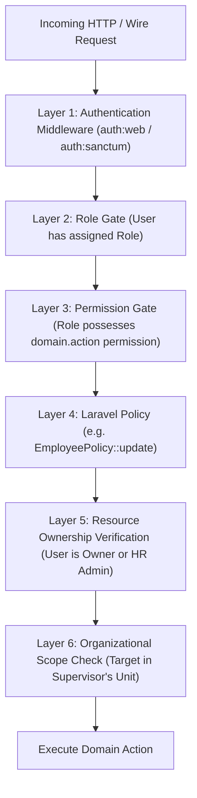
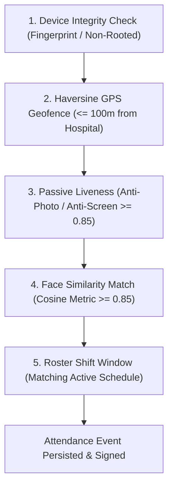

# SECURITY AND PRIVACY ARCHITECTURE SPECIFICATION

**Document Identifier**: `/docs/04-security.md`  
**System Name**: Hospital Human Resources, Payroll, Attendance, and Doctor Scheduling System  
**Target Organization**: Single Hospital Enterprise Deployment (Juwita Hospital)  
**Role**: Senior Application Security & Privacy Architect  
**Status**: APPROVED SECURITY ARCHITECTURE BASELINE  

---

## 1. SECURITY & PRIVACY OBJECTIVE

The system acts as the custodian of highly confidential healthcare staff data, including employee personal identifiers (NIK/KTP), doctor professional licenses (STR/SIP), sensitive banking records, payroll compensations, statutory tax withholdings (PPh 21), GPS coordinates, and mathematical biometric facial representations.

This architecture enforces **Defense-in-Depth**, **Zero-Trust for Biometric Clients**, and the principle of **Least Privilege** across all software and infrastructure layers.

---

## 2. COMPREHENSIVE THREAT MODEL

| Threat Identifier & Category | Attack Surface | Potential Impact | Technical Mitigation Control | Detection Mechanism | Audit Requirement |
|---|---|---|---|---|---|
| **THREAT-01**: Credential Stuffing / Brute Force | Login endpoints (`/login`) | Account takeover, identity impersonation | Rate limiting (Redis-backed 5 req/min/IP), progressive delay, account lockout after 5 consecutive failures. | Spike in HTTP 429 and failed login counters in Redis. | Log actor IP, user agent, attempted email, and timestamp to `audit_logs`. |
| **THREAT-02**: Insecure Direct Object Reference (IDOR) | Document & profile URLs (`/employees/{uuid}`, `/documents/{uuid}`) | Unauthorized exposure of employee KTP, salary, or medical licenses | Laravel Model Policies (`EmployeePolicy`, `DocumentPolicy`) strictly enforcing resource ownership and organizational scope. | Access denied exceptions (HTTP 403) monitored in application telemetry. | Record `authorization.denied` event with actor ID, targeted resource, and route. |
| **THREAT-03**: Malicious File Upload | Document upload endpoints | Remote Code Execution (RCE), web shell upload | Strict MIME-type sniffing, extension whitelisting, upload isolation in Google Shared Drive (never stored executable in web root). | Rejection of non-whitelisted MIME streams; size threshold validation. | Log file name, declared MIME, detected MIME, uploader ID. |
| **THREAT-04**: Biometric Photo / Video Spoofing | Kiosk & Mobile camera frame capture | Attendance fraud, buddy punching | Two-tier passive anti-spoofing in Face AI microservice (texture, reflection, frequency domain analysis); minimum liveness score 0.85. | Liveness confidence score < 0.85 flags event as `spoof_detected`. | Persist diagnostic score and device fingerprint; alert HR security. |
| **THREAT-05**: GPS Mocking / Geofence Spoofing | Attendance clock-in payload | Falsified on-site presence | Haversine distance verification on backend; rejection of mock location flags from Android/iOS location APIs; IP-range cross-check. | Coordinates outside hospital radius (> 100m) or abnormal coordinate jumps. | Log exact lat/long, calculated distance, and device flags in `attendance_events`. |
| **THREAT-06**: Client Tampering (`verified=true`) | REST API / Livewire wire payload | Attendance bypass without biometric evaluation | Server-authoritative architecture: Laravel **never** trusts client-submitted verification flags; all verification tokens originate from Face AI service. | Payload containing unverified signature rejected with 422 Unprocessable. | Flag unauthorized API parameter manipulation. |
| **THREAT-07**: Biometric Template Extraction | Database storage (`employees.face_biometric_vector`) | Irreversible personal biometric identity theft | Discard raw photos immediately after enrollment; store only 128-d/512-d mathematical embeddings; encrypt column with AES-256 (`encrypted` cast). | Unauthorized DB query patterns or direct SQL dumps outside app key context. | Log administrative access to employee biometric records. |
| **THREAT-08**: Google Drive Public Leakage | Google Workspace Shared Drive | Public exposure of KTP, contracts, doctor STR | Service Account credentials with no public link creation; files streamed via signed, 15-minute temporary application proxy URLs. | Audit of Google Workspace Drive sharing settings (disabled external sharing). | Audit log records every generated document preview URL. |
| **THREAT-09**: Financial Record Mutation | Finalized Payroll Runs | Fraudulent salary disbursements, retroactive audit tampering | Immutable database status (`status = 'finalized'`); database rules/triggers preventing `UPDATE`/`DELETE`; corrections via adjustment line-items. | Exception thrown on attempted update of finalized payroll ID. | Log all payroll status transitions and finalization sign-offs. |
| **THREAT-10**: Log Data Leakage | Application log files (`laravel.log`) | Secret or PII leakage into log aggregator | Automatic sanitization engine ([AuditService](file:///Users/bagas/Projects/Other-copy/payroll-juwita/app/Services/Audit/AuditService.php)) redacting passwords, tokens, API keys, and biometric vectors. | Static code analysis scanning for raw logger statements with sensitive objects. | Monitored log review. |

---

## 3. AUTHENTICATION & CREDENTIAL POLICIES

### 3.1 Proposed Password Standard
- Minimum length: 12 characters.
- Must include uppercase, lowercase, numeric, and special character symbols.
- Passwords matched against the HaveIBeenPwned compromised credential dictionary.
- Hashing: **Bcrypt** with a mandatory cost factor of 12 (or Argon2id where supported).

### 3.2 Session Security Architecture
- **Cookie Security**:
  - `HttpOnly = true` (Prevents client-side JavaScript access via XSS).
  - `Secure = true` (Transmitted strictly over HTTPS).
  - `SameSite = Lax` (Mitigates Cross-Site Request Forgery - CSRF).
- **Session Lifetime**:
  - Active lifetime: 120 minutes of inactivity.
  - Absolute session hard-cap: 12 hours (forces re-authentication for clinical safety).
- **Session Invalidation**:
  - Immediate session invalidation on password change, role modification, or logout.
  - Native protection against Session Fixation: Automatic session ID regeneration upon login (`session()->regenerate()`).

### 3.3 Rate Limiting & Throttling
- `/login`: 5 failed attempts per IP/Email combination per minute $\rightarrow$ 60-second progressive lockout.
- `/attendance/verify`: 10 attempts per minute per device $\rightarrow$ throttled to prevent automated dictionary attacks against Face AI.

---

## 4. AUTHORIZATION LAYERS & POLICY ENFORCEMENT

The application enforces a **6-Tier Authorization Pipeline**:



### Resource-Level IDOR Protection Rule:
Every route accepting a resource identifier must resolve through a Policy assertion prior to database retrieval or modification:
```php
public function update(User $user, Employee $employee): bool
{
    // 1. Super Admin / HR Manager always permitted
    if ($user->hasRole(['super_admin', 'hr_manager'])) {
        return true;
    }

    // 2. Supervisor restricted to subordinate units
    if ($user->hasRole('supervisor')) {
        return $user->employee?->unit_id === $employee->unit_id;
    }

    // 3. Employee self-service restricted to personal record
    return $user->employee?->id === $employee->id;
}
```

---

## 5. FILE & OBJECT STORAGE SECURITY (Google Drive)

### 5.1 Upload Verification Matrix
- **Maximum File Size**: 10 MB per document.
- **Allowed MIME Types**: `application/pdf`, `image/jpeg`, `image/png`.
- **Validation**: Server-side inspection using `finfo` byte inspection (ignoring client-provided extension).
- **Filename Sanitization**: Uploaded files renamed to random UUIDv4 (`{uuid}.pdf`) to neutralize directory traversal and null-byte injection attacks.

### 5.2 Google Workspace Shared Drive Security
- Shared Drive configured with **External Sharing Disabled** (files cannot be shared outside the hospital's Google Workspace domain).
- Laravel connects using a dedicated Google Service Account provisioned with minimum "Content Manager" privileges on the specific Shared Drive folder only.
- Service Account private key JSON stored outside the web root (`storage/app/secrets/google-service-account.json`) with file permissions `0600`.
- Service credentials are **strictly excluded from Git** via `.gitignore`.

---

## 6. BIOMETRIC SECURITY & FACE AI ISOLATION

### 6.1 Biometric Privacy Axioms
1. **Raw Photo Purge**: Facial photos captured during enrollment are processed in memory, converted into a 128-d or 512-d normalized floating-point embedding vector, and immediately purged from RAM and disk.
2. **No Reverse Reconstruction**: Mathematical embeddings cannot be reverse-engineered into the original photographic image.
3. **No External Storage**: Biometric vectors are **strictly forbidden** from being transmitted to or stored in Google Drive.
4. **Encryption at Rest**: Stored in PostgreSQL with application-level AES-256 encryption (`casts => ['face_biometric_vector' => 'encrypted']`).
5. **No Download Capability**: There is zero API, controller, or UI functionality allowing any user to download raw or vectorized biometric data.

### 6.2 Face AI Service-to-Service Security
- Microservice runs in an isolated Docker network without an externally mapped host port.
- Authentication between Laravel and Face AI is secured via a shared high-entropy header secret: `X-Internal-Secret: ${FACE_AI_SECRET}`.
- Payload limit: Maximum 5 MB per frame.
- Timeout: 3.0 seconds hard timeout to prevent worker starvation.

---

## 7. ATTENDANCE FRAUD DEFENSE IN-DEPTH



### Defense Against Specific Fraud Vectors:
- **Buddy Punching**: Eliminated by mandatory facial feature matching against the enrolled identity vector.
- **Photo/Screen Playback**: Neutralized by Face AI passive liveness detection analyzing moiré patterns and skin texture.
- **GPS Spoofing Apps**: Detected through mobile browser API validation (rejecting mock provider indicators) and verified against client IP subnets.
- **Replay Attacks**: Check-in requests require a short-lived nonce (valid for 60 seconds) generated upon opening the check-in screen.

---

## 8. DATABASE & SECRETS MANAGEMENT

### 8.1 Database Security Controls
- PostgreSQL port `5432` binds exclusively to `127.0.0.1` and internal Docker bridge networks; no direct public internet exposure.
- Application connects using a non-superuser role (`payroll_app_user`) restricted to DDL/DML on the `payroll_juwita` schema.
- Password and sensitive columns (KTP, bank account number, biometric vectors) utilize Laravel's native AES-256-CBC encryption.

### 8.2 Secrets Hierarchy
- All keys (`APP_KEY`, `DB_PASSWORD`, `REDIS_PASSWORD`, `FACE_AI_SECRET`, `GOOGLE_APPLICATION_CREDENTIALS`) injected via environment variables or Docker secrets.
- Hardcoded secrets in source code or committed documentation are strictly prohibited.
- Periodic 90-day rotation schedule established for Google Service Account keys and internal service tokens.

---

## 9. AUDIT LOGGING & TAMPER PROOFING

### 9.1 Mandatory Auditable Operations
1. Authentication (Login, Logout, Failed attempts, Password resets).
2. Authorization Failures (403 Forbidden events).
3. Employee & Doctor record mutations.
4. Salary and Compensation adjustments.
5. Leave application approvals and rejections.
6. Attendance manual adjustments.
7. Payroll execution, item recalculation, and finalization.
8. Document uploads, preview link generation, and deletions.
9. Biometric enrollment and vector updates.
10. System configuration modifications.

### 9.2 Immutability & Masking Control
- The `audit_logs` table has no `updated_at` column and rejects `UPDATE` and `DELETE` queries via PostgreSQL table rules.
- Automatic payload sanitization in [AuditService](file:///Users/bagas/Projects/Other-copy/payroll-juwita/app/Services/Audit/AuditService.php) scrubs `password`, `token`, `secret`, `face_embedding`, and `biometric_template` prior to insertion.

---

## 10. PRIVACY FRAMEWORK & DATA RETENTION

### 10.1 Sensitive Data Classification

| Data Category | Examples | Sensitivity Tier | Storage Location | Encryption at Rest |
|---|---|---|---|---|
| **Biometric Features** | 128-d/512-d Face Vector | High (Critical) | PostgreSQL (`employees`) | AES-256 Encrypted |
| **Personal Identifiers** | NIK KTP, Family Card, NPWP | High | PostgreSQL (`employees`) | AES-256 Encrypted |
| **Financial & Banking** | Bank Account Number, Salary | High | PostgreSQL (`employee_salaries`) | AES-256 Encrypted |
| **Medical Credentials** | STR, SIP Numbers, Certificates | Medium | PostgreSQL / Google Drive | Encrypted Transit / Storage |
| **Geolocation Data** | Clock-in Latitude & Longitude | Medium | PostgreSQL (`attendance_events`) | Standard DB Protection |
| **Audit Trails** | State snapshots, IP, User Agent | Low | PostgreSQL (`audit_logs`) | Standard DB Protection |

### 10.2 Retention Framework

| Category | Retention Duration | Justification | Disposal Procedure |
|---|---|---|---|
| **Terminated Employee Profiles** | 10 Years post-separation | Indonesian Labor / Tax statutory record-keeping | Soft-deleted; archived to cold storage after 10 years. |
| **Payroll Runs & Form 1721-A1** | 10 Years | Indonesian Tax Law (KUP) audit compliance | Permanently archived in immutable cold storage. |
| **Attendance Events (GPS/Scores)** | 24 Months | Operational audit & dispute resolution | Automated purge job of raw events > 24 months. |
| **Biometric Feature Vectors** | Duration of Active Employment | Personal data minimization | Purged from database within 24 hours of employee termination. |
| **System Audit Logs** | 7 Years | Security compliance and forensic discovery | Immutable database retention. |

*Note: Legal basis (statutory compliance vs. employment agreement) requires formal confirmation by Juwita Hospital legal counsel.*

---

## 11. PRE-PRODUCTION SECURITY CHECKLIST

- [ ] **Infrastructure**: Nginx enforces TLS 1.3 with HSTS (`Strict-Transport-Security: max-age=31536000; includeSubDomains`).
- [ ] **Network**: PostgreSQL and Redis ports (5432, 6379) closed to public internet traffic.
- [ ] **Application**: `APP_DEBUG=false` confirmed in production environment.
- [ ] **Secrets**: All `.env` secrets stored in secure vault/CI pipeline; zero secrets present in Git history.
- [ ] **Storage**: Google Workspace Shared Drive external link sharing disabled at organization domain level.
- [ ] **Biometrics**: Enrolled face vectors verified to use encrypted attributes; raw image storage verified absent.
- [ ] **Authentication**: Login rate limiters verified active via automated feature tests.
- [ ] **Authorization**: All routes covered by explicit Policy unit and feature tests.
- [ ] **Audit Trail**: Verification that [AuditService](file:///Users/bagas/Projects/Other-copy/payroll-juwita/app/Services/Audit/AuditService.php) redacts passwords and biometrics under all failure conditions.
- [ ] **Backups**: Database dump encryption verified with automated GPG test restores.
